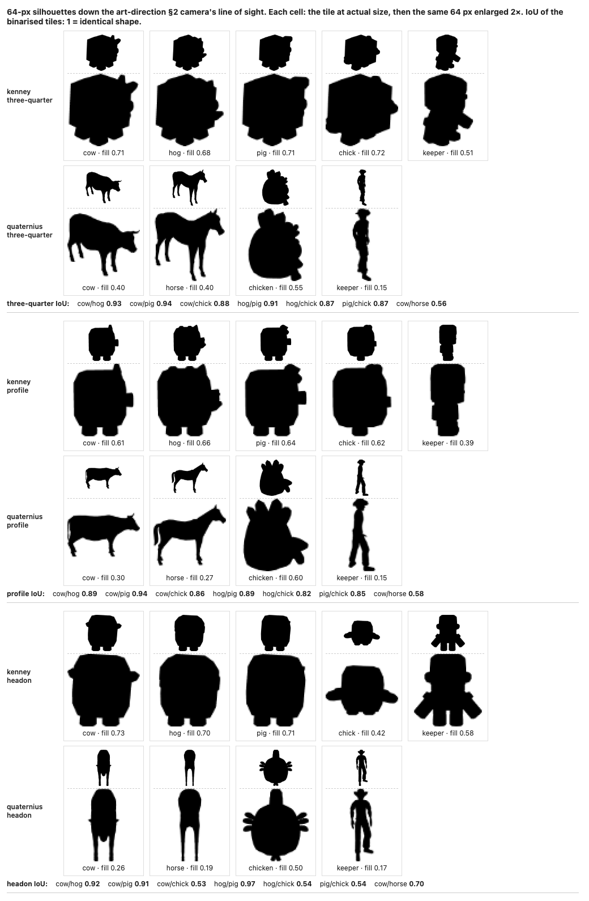
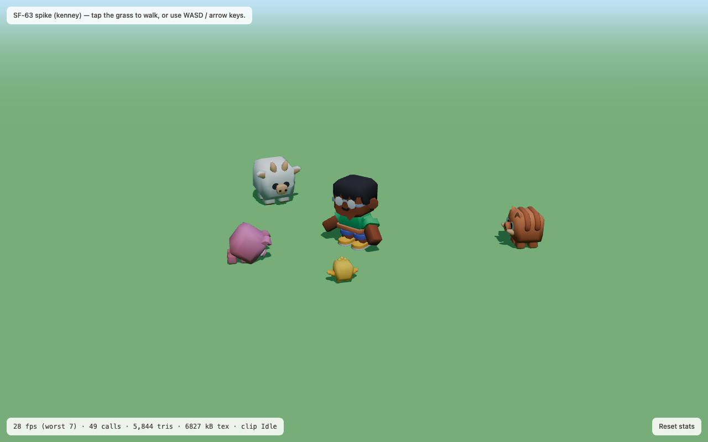

# ADR-0003: Asset pack — Synty SIMPLE for the farm, Kenney as the free fallback

- **Status:** proposed
- **Date:** 2026-09-08
- **Deciders:** James (sole developer) — this one needs his call, because the
  recommendation costs money and art-direction §9 Q1 already reserved it for him.
- **Ticket:** SF-64 "Spike: asset pack decision"
- **Corrected:** 2026-10-07 — see below.

> **Correction (2026-10-07).** The Kenney column of the 2026-09-08 comparison
> was wrong: it said Kenney has no 3D farm animals. It has two packs this ADR
> missed, both downloaded and inspected on 2026-10-07:
>
> - **[Cube Pets 2.0](https://kenney.nl/assets/cube-pets)** (`License.txt`:
>   "Creation date: 26-03-2026") — 24 animals as **GLB + FBX + OBJ**, one
>   512 × 512 `colormap.png` atlas, one material. Farm-relevant: `animal-cow`
>   (578 tris), `animal-pig` (424), `animal-hog` (706), `animal-chick` (490);
>   also bunny, dog, cat, fox, deer. **No sheep, horse, goat, adult chicken,
>   rooster or duck.** Rigid node animation (no skins), clips `static`, `idle`,
>   `walk`, `run`, `eat`, `dance`, `gesture-positive`, `gesture-negative`.
>   Download: `https://kenney.nl/media/pages/assets/cube-pets/44e58e945f-1774520254/kenney_cube-pets_1.0.zip`.
> - **[Mini Characters](https://kenney.nl/assets/mini-characters)** (1.0,
>   17-07-2024) — `character-male-a..f`, `character-female-a..f`, 723 tris,
>   skinned (14 joints), clips including `idle`, `walk`, `sprint`, `pick-up`,
>   `interact-right/left`, `emote-yes`, `emote-no`, `sit`; plus wheelchairs and
>   mobility aids. Download:
>   `https://kenney.nl/media/pages/assets/mini-characters/bfc7e272b4-1774770718/kenney_mini-characters.zip`.
>
> Both `License.txt` files say: *"License: (Creative Commons Zero, CC0)
> http://creativecommons.org/publicdomain/zero/1.0/ — You can use this content
> for personal, educational, and commercial purposes. Support by crediting
> 'Kenney' or 'www.kenney.nl' (this is not a requirement)"*.
>
> **They fail the §3 silhouette test, by more than Quaternius does.** Rendered
> flat black down the §2 camera's line of sight at their §2 world sizes, shrunk
> to 64 × 64 px and binarised (`e2e/spike-kenney.spec.ts` on
> `spike/kenney-silhouette`, draft PR #112), the pairwise intersection-over-union
> of the four farm animals is **0.82–0.94** at three-quarter and profile view.
> The Quaternius cow/horse pair this ADR already called failing, measured the
> same way, is **0.56–0.58**. By eye the cow, hog and pig are the same rounded
> square on two stub legs; the chick only separates head-on, where its wings
> stick out (IoU 0.53–0.54). In colour they are easy to tell apart, but §3 is a
> shape rule. Full numbers under [Evidence](#evidence);
> [contact sheet](img/kenney-silhouettes.png).
>
> The Decision below is unchanged — Synty SIMPLE — but **Kenney replaces
> Quaternius as the free fallback**, for the reasons under Alternatives.

## Context

Art-direction §7 compares Kenney, Synty POLYGON and Quaternius and recommends
**"Quaternius as the single pack, Mixamo for the keeper's clips"**. That was a
paper comparison. SF-63's spike put the candidates in the actual engine at the
actual camera, and three of the assumptions behind that recommendation turn out
to be wrong. The evidence is in ADR-0004 and in the screenshots below; this ADR
records what the packs actually contain, what they actually cost, and what their
licences actually say as of 2026-09-08.

Three constraints do the deciding:

- **§8, one pack only.** Mixing sources is banned, so a pack has to cover the
  whole farm — the seven species in the implementation plan (chicken, cow, pig,
  sheep, horse, plus the petting-zoo animals) *and* a humanoid keeper — in one
  style.
- **§3, readable silhouette at 64 px.** A six-year-old on a 360-px phone has to
  tell a cow from a horse. That rules out thin legs and small heads.
- **glTF, rigged, with idle + walk.** ADR-0001 committed to buying pre-animated
  assets precisely so we author no animation.

## What the packs actually are

Measured or quoted on 2026-09-08. "Verified" means the file was downloaded and
inspected, not read about.

| | Kenney | Quaternius | Synty POLYGON Farm | Synty SIMPLE (Farm Animals + People) |
| --- | --- | --- | --- | --- |
| **Farm animals, 3D** | *Corrected 2026-10-07:* [Cube Pets 2.0](https://kenney.nl/assets/cube-pets) — **cow, pig, hog, chick**; no sheep, horse, goat or adult chicken — verified. (The older Animal Pack / Redux are 2D, which is what the first version of this row found.) | fragmented across two packs and two styles (below) | **none** — the [store page](https://syntystore.com/products/polygon-farm-pack) lists buildings ×15, props ×165, plants ×173, environment ×67, characters ×6, vehicles ×11, and no animals | 23 models / 10 species: "Pig (x1), Sheep (x2), Cow (x2), Bull (x2), Horse (x5), Chicken (x2), Rooster (x2), Chick (x1), Duck (x3), Goat (x2)" |
| **Humanoid keeper** | [Mini Characters](https://kenney.nl/assets/mini-characters) — 12 characters (male/female a–f), 723 tris, skinned (14 joints) — verified | "Farmer" in Ultimate Modular Men, 11 characters — verified | 6 rigged characters (farmer, farm boy) | SIMPLE People: 17 characters × 3 variations, ~300 tris |
| **Rigged + animated** | yes. Animals: rigid node animation, `idle`, `walk`, `run`, `eat`, `dance`, `gesture-positive/negative`. Keeper: skinned, `idle`, `walk`, `sprint`, `pick-up`, `interact-*`, `emote-yes/no`, `sit` — clips embedded in each file — verified | yes: cow/horse 13 clips (Idle, Walk, Eating, Gallop…), Farmer 24 clips (Idle, Walk, Run, Wave, Interact) — verified | characters rigged but **"set up with Mecanim (no animations included)"** | "Each Animal has an Idle, Walk, Run and Eat animation"; people 16 clips incl. Idle, Walking, Running, Wave |
| **Format** | **GLB** + FBX + OBJ — verified | **glTF** + FBX + OBJ + Blend for the two packs used; Farm Animal Pack is FBX/OBJ/Blend only, **no glTF** — verified | "Unity 2022.3 package", "Unreal 4.25 project", "Godot 4.6.2 project", "FBX Source Files" | Unity package + **FBX source files** |
| **Licence** | CC0 1.0. From each pack's own `License.txt`: *"You can use this content for personal, educational, and commercial purposes. Support by crediting 'Kenney' or 'www.kenney.nl' (this is not a requirement)"* — [licence](http://creativecommons.org/publicdomain/zero/1.0/) | **contested — see below** | [One-Time Purchase Licence](https://syntystore.com/pages/one-time-purchase-licence) | same One-Time Purchase Licence |
| **Cost** | $0 | $0 | **$49.99 USD** | **$19.99 + $19.99 = $39.98 USD** one-time (or [SyntyPass](https://syntystore.com/products/syntypass) from $30/mo) |
| **Style fit vs §3** | one coherent cube style, animal and keeper — but **fails the 64-px silhouette test**: cow/hog/pig/chick IoU 0.82–0.94 (see Evidence) | **fails** — see the render | cohesive but adult-proportioned | closest match on the store previews: chunky, flat-shaded, stub limbs — **not verified in engine, the pack is paid** |
| **Redistribution** | none. Public domain | may not redistribute *as assets*; shipping inside a Product is explicit | 5 seats per licence; "You must not share the source files of any Assets outside your team"; "you must not distribute our Assets as stock images or stock art (2D or 3D) or otherwise share them for re-use by third parties" | same |
| **Attribution** | not required | not required | not required | not required |

### Quaternius is two different packs in two different styles

- **Ultimate Animated Animal Pack** (July 2021) — 12 models, verified by
  download: Alpaca, Bull, Cow, Deer, Donkey, Fox, Horse, Horse_White, Husky,
  ShibaInu, Stag, Wolf. **No chicken, no pig, no sheep.**
- **Farm Animal Pack** (June 2018) — 7 models, verified: Cow, Horse, Pig,
  Sheep, Llama, Pug, Zebra. **No chicken**, and **no glTF export** (FBX / OBJ /
  Blend only), so it needs a Blender round-trip.
- Both are naturalistic low-poly: thin legs, small heads. The spike render below
  is what that looks like at the §2 camera.
- A **chunky, big-headed** Quaternius chicken does exist (CC0, animated, 2,904
  tris, 4 bones, Idle/Walk/Dance clips — verified by download from
  <https://poly.pizza/m/ineV9pU5VL>), and it is the style §3 describes. It is in
  **no pack listed on quaternius.com**. So Quaternius cannot supply one coherent
  farm under the §8 one-pack rule; it supplies two half-farms in two styles.

### The Quaternius licence changed under us

Every pack page still shows a **CC0** badge linking
<https://creativecommons.org/publicdomain/zero/1.0/>. The site-wide licence page
<https://quaternius.com/license.html>, **last updated 2026-08-28**, now publishes
the **Quaternius Asset Licence (QAL) v1.0** instead:

> §2 … "Use, copy, and modify the Assets; Incorporate the Assets (in original or
> modified form) into a Product; Publish, distribute, sell, sublicense, and
> otherwise commercially exploit that Product, without owing us any fee,
> royalty, or credit … No attribution is required."
>
> §3(a) "You may not extract, repackage, sublicense, sell, or otherwise
> redistribute the Assets (in original or modified form) as a standalone asset,
> asset pack, stock file, template, or similar product … It does not restrict
> distributing a completed Product that merely incorporates the Assets."
>
> §7 "Changes will not apply retroactively to Assets you've already obtained
> under an earlier version."

For the game itself this is harmless: shipping `.glb` files inside a web build is
a Product, explicitly allowed by §2/§3(a). The part to be careful about is
committing loose `.glb` files to a repo — fine while `jhoffman-dev/sanctuary-farm`
is private, worth a second look if it is ever made public. Two statements
disagreeing on the same site is itself a small risk: a free pack whose terms move
is a dependency we do not control.

### Mixamo

**Not evaluated.** Mixamo requires an Adobe sign-in, which an agent cannot
complete, so no clip was downloaded or retargeted. The spike therefore used
characters that already carry idle + walk. What Mixamo would add is breadth —
`carry`, `pet`, `dance` from art-direction §8 — retargeted onto whatever
humanoid we pick. What it costs is a Blender FBX→glTF step per clip and
foot-slide QA on chunky proportions. Both Quaternius' Farmer (24 clips) and
Synty SIMPLE People (16 clips) already cover idle/walk/run/wave without it, so
Mixamo is a Phase 3 nicety, not a dependency.

## Decision

**Buy Synty SIMPLE Farm Animals + SIMPLE People — US$39.98 one-time, 5 seats —
and make the SIMPLE line the single pack.** *(Revised 2026-10-07:)* Keep
**Kenney Cube Pets + Mini Characters** as the zero-cost fallback, in place of
Quaternius.

The deciding reason is coverage, not taste: **no free option has a rigged,
animated adult chicken in the same style as its cow**, and the nest hollow, the
eggs and the hatch ceremony are the core loop, not decoration. Kenney's Cube
Pets have a chick but no hen, and no sheep or horse. POLYGON Farm has no
animals and no animations. Quaternius has two styles and no chicken in either
pack. SIMPLE Farm Animals has all seven species plus ducks and goats, each with
Idle/Walk/Run/Eat, and SIMPLE People gives the keeper the same look for another
$19.99.

The 2026-10-07 silhouette test adds a second reason: the one free pack that
*does* hold a coherent farm style, Kenney's, fails §3 at 64 px — cow, hog and
pig share a silhouette (IoU 0.89–0.94, against 0.56–0.58 for the Quaternius
cow/horse pair already judged failing). So no free option clears §3 either.

$39.98 is inside the "≈ US$50" that art-direction §9 Q1 already put to James, and
it is a third of the POLYGON price for the thing we actually need.

## Alternatives considered

- **Quaternius alone (the art-direction recommendation).** Free, CC0-badged,
  ships glTF, genuinely good rigs. Rejected on the two spike checks: the
  animals fail §3 at 64 px (see ADR-0004), and no single pack covers the farm —
  taking the chunky chicken *and* the naturalistic cow breaks §8 in the first
  week. *(2026-10-07:)* No longer the fallback. Kenney is one style, ships
  GLB, has an uncontested CC0 and §8 clip names; Quaternius is two styles
  under a licence that moved. Quaternius still scores better on shape (cow /
  horse IoU 0.56–0.58 against Kenney's 0.89–0.94) and has a horse and a
  sheep, so it is the option if §3's shape rule outranks §8's one-style rule.
- **Kenney Cube Pets + Mini Characters** *(row rewritten 2026-10-07 — the
  first version said Kenney had no 3D animals, which was wrong)*. $0, CC0 with
  no ambiguity, **GLB in the box**, one material and one 512² atlas per pack,
  and clip names that already match art-direction §8 — `idle`, `walk`, `eat`,
  plus `dance` for the hatch dance and `gesture-negative` for the glum pose.
  The walk is in place (no root motion to strip) and `metallicFactor` is
  already 0. In the spike (`?spike=3d&pack=kenney`) the animals' rigid node
  clips and the keeper's skinned clips both crossfade through the same
  `AnimationMixer` code, at 5.8 k triangles and 49 draw calls against
  Quaternius' 26 k and 65. Two reasons it is the fallback and not the pick:
  it **fails the §3 silhouette test** outright (cow/hog/pig IoU 0.89–0.94 at
  three-quarter and profile — the cube *is* the silhouette; only colour and
  size tell them apart), and it **lacks sheep, horse, goat and an adult
  chicken**, which would have to be modelled in Blender in the cube style. If
  James declines the purchase, this is the free path, and §3 has to be
  rewritten from "silhouette" to "colour + size + silhouette".
- **Synty POLYGON Farm ($49.99).** More money for buildings and props we can
  model ourselves, no animals, and no animations on the characters. The pack
  art-direction §7 singled out is the weakest fit of the four.
- **SyntyPass ($30/month).** Cheaper only if we keep buying; a recurring cost on
  a free, no-revenue project is the wrong shape. Two one-time packs is $39.98
  once.
- **Mixing Quaternius animals with a Synty keeper.** Banned by §8, and the
  spike's cow-and-chicken frame shows why: two low-poly styles side by side
  read as a bug.

## Consequences

- **Positive:** one style for every species the game names, idle/walk/run/eat on
  every animal, a matching keeper, and no animation authoring. Attribution is
  not required, so no credits burden. 5 seats covers James plus any future help.
- **Cost:** US$39.98, one time. A Blender FBX→glTF conversion step we do not
  need with Quaternius (Synty ships FBX source, no glTF) — one-off per model,
  scriptable, and ADR-0004 already specifies the `gltf-transform` half of that
  pipeline.
- **Risk — the EULA and a public web build.** A shipped web game serves its
  `.glb` files to the browser, so anyone can save them. That is incorporation
  into a Product (permitted), not distribution "as stock art" (forbidden), but
  the EULA has no clause about extraction from a shipped build, and Synty's FAQ
  reserves a custom licence for some distribution platforms. **Committing Synty
  source files to the repo is the part to avoid** — the repo would have to keep
  only built `.glb`s, or stay private. Flagged as open question 1.
- **Risk — style unverified in engine.** The SIMPLE line was judged from store
  previews only; the pack is paid and could not be downloaded. First job after
  purchase is to redo ADR-0004's 64-px silhouette test on real SIMPLE models
  before any world-building depends on them.
- **Follow-ups:** the asset pipeline ticket (FBX → glTF → `gltf-transform` →
  `public/models/`), the clip-renaming step (§8 wants `idle`/`walk`/`eat`;
  Synty and Quaternius use their own names — Kenney alone already matches), and
  the face-kit ticket from §3. *(2026-10-07:)* After purchase, run SIMPLE
  through the same measurement — `e2e/spike-kenney.spec.ts` renders any pack's
  64-px tiles and IoU given a cast entry — so the pick is judged on the number
  the fallback failed. If the fallback is taken instead: a ticket to model
  **sheep, horse and an adult chicken in Blender in the Cube Pets style**, and
  one to load the shared `colormap.png` atlas once (each optimized `.glb`
  embeds its own copy: 5 models = 6.8 MB of GPU texture where 1.4 MB would
  do).

## What would change this decision

1. **James declines the spend or the EULA.** *(Revised 2026-10-07.)* Then it
   is Kenney Cube Pets + Mini Characters, art-direction §3's 64-px rule must
   be rewritten to accept colour and size as the readability cue (the cube
   silhouettes do not separate on shape), and sheep, horse and an adult
   chicken are modelled in Blender in the cube style.
2. **The SIMPLE models fail the 64-px test on inspection.** Then no candidate
   satisfies §3 — Kenney measurably does not — and the honest answer is either
   to commission or model the farm animals ourselves in Blender, or to relax §3
   as in (1) and take Kenney at $0.
3. **James decides colour + size is enough.** §3 says "black silhouette", and
   on that rule Kenney fails. In colour, at the §2 camera, the white horned
   cow, pink pig, brown hog and yellow chick are unmistakable (screenshot
   below), and the chick is 0.5 units against the cow's 1.3. If the rule is
   loosened to that, Kenney becomes the pick at $0 — with the missing species
   as Blender work.
4. **Quaternius publishes one coherent chunky farm pack.** It is an active
   catalogue; a single pack with chicken + cow + pig + sheep + a humanoid in the
   big-head style would beat a paid pack on every axis except the licence
   stability question.
5. **The repo goes public.** That sharpens the Synty source-file question and
   would also want a second look at QAL §3(a).

## Evidence

Screenshots from the SF-63 spike, all at the art-direction §2 camera. Full
numbers in ADR-0004.

Quaternius' naturalistic cow and horse with the chunky chicken between them —
the two styles that cannot share a farm. The chicken renders grey because the
poly.pizza mirror's conversion mangled its base colours; see
`apps/web/public/spike/LICENSES.md`.

The §3 test. At 65 px the cow and the horse are the same brown quadruped, and
the chicken (32 px) is a dot. Thin legs and small heads are what fail here.

### Kenney Cube Pets + Mini Characters (2026-10-07)

From `spike/kenney-silhouette` (draft PR #112, not for merge). Each model is
rendered alone with a black `MeshBasicMaterial` override on white, down the
§2 camera's line of sight, at its §2 world size (chick 0.5, pig and hog 0.9,
cow 1.3, keeper 1.6), at frame 0 of `idle`; the render is cropped square
around the silhouette and shrunk to a 64 × 64 tile, then binarised at 50 %.
The Quaternius cow and horse went through the identical path as the reference.

Pairwise IoU of the binarised 64-px tiles (1 = the same shape):

| Pair | three-quarter | profile | head-on |
| --- | --- | --- | --- |
| cow / hog | 0.93 | 0.89 | 0.92 |
| cow / pig | 0.94 | 0.94 | 0.91 |
| cow / chick | 0.88 | 0.86 | 0.53 |
| hog / pig | 0.91 | 0.89 | 0.97 |
| hog / chick | 0.87 | 0.82 | 0.54 |
| pig / chick | 0.87 | 0.85 | 0.54 |
| *Reference: Quaternius cow / horse* | *0.56* | *0.58* | *0.70 (end-on)* |

Filled ratio of the tile (three-quarter): Kenney cow 0.71, hog 0.68, pig 0.71,
chick 0.72, keeper 0.51; Quaternius cow 0.40, horse 0.40, chicken 0.55,
keeper 0.15. Verdict: **fail** — every Kenney farm-animal pair is above the
reference at three-quarter and profile.

| Kenney scene | 1280 × 800 | 360 × 640 |
| --- | --- | --- |
| Draw calls | 49 (Quaternius: 65) | 44 |
| Triangles | 5,844 (Quaternius: 26,026) | 5,138 |
| GPU texture memory (estimate) | 6.8 MB — five embedded copies of a 512² atlas | same |
| First rendered frame | 524–540 ms | 523 ms |
| Sustained FPS, avg (worst) | 27.5 (18.8); Quaternius 24.8 (17.9) in the same session | 60.0 (40.0) |

Headless Chromium on a loaded laptop (load average ≈ 10) — compare the two
packs with each other, not with the budget.

The same farm in colour: nobody would mistake the cow for the pig here. The
silhouette rule is what this pack fails, not readability in general.

