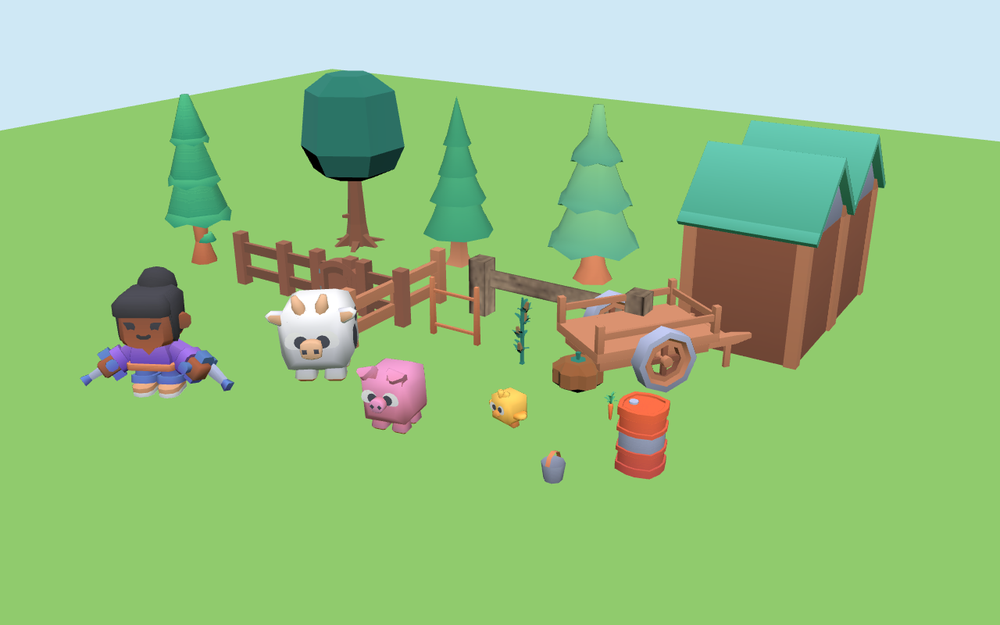

# ADR-0003: Asset pack — Kenney (Cube Pets, Mini Characters, world kits)

- **Status:** Accepted (2026-10-07, James Hoffman)
- **Date:** proposed 2026-09-08; corrected and accepted 2026-10-07
- **Deciders:** James Hoffman (sole developer)
- **Ticket:** SF-64 "Spike: asset pack decision" (#93)

> **History.** The 2026-09-08 draft recommended buying Synty SIMPLE Farm
> Animals + SIMPLE People (US$39.98) and missed that Kenney has 3D farm
> animals at all. The 2026-10-07 correction found Kenney Cube Pets, measured
> its 64-px silhouettes (they fail §3's shape-only rule, below), and kept Synty
> as the pick with Kenney as the free fallback. James then chose Kenney.
> The measurements from both rounds are kept under [Evidence](#evidence).

## Context

Art-direction §7 compared Kenney, Synty POLYGON and Quaternius on paper and
recommended Quaternius. SF-63's spike put the candidates in the actual engine at
the actual camera (ADR-0004), and the paper comparison did not survive it. This
ADR records what the packs actually contain, cost and license, and the choice.

Three constraints do the deciding:

- **§8, one pack only.** Mixing sources is banned, so a source has to cover the
  whole farm — the seven species in the implementation plan (chicken, cow, pig,
  sheep, horse, plus the petting-zoo animals), a humanoid keeper, *and* the
  world (barn, shed, fences, pond, farmhouse) — in one style.
- **§3, readable at 64 px.** A six-year-old on a 360-px phone has to tell a cow
  from a pig. The 2026-09-08 rule said this must hold on *shape alone*.
- **glTF, rigged, with idle + walk.** ADR-0001 committed to pre-animated assets
  precisely so we author no animation.

## Decision

**Kenney is the asset source for the whole farm: [Cube Pets](https://kenney.nl/assets/cube-pets)
for the animals, [Mini Characters](https://kenney.nl/assets/mini-characters)
for the keeper, and the Kenney kits inventoried [below](#world-kit-inventory-2026-10-07)
— Fantasy Town Kit, Survival Kit, Mini Forest and Food Kit — for the world.**
CC0, US$0, GLB in the box, and the animal clips already carry the §8 names.
Species and world pieces Kenney does not have (sheep, horse, hen; the barn's
identity, nest, trough, hay bale, pond) are modelled in Blender in the same
style, against the same atlases.

James's reason, in his words: *"The Synty pack is UGLY!!! The kenney pack is
much cuter which matters for a kids game (heck even for adults). Also, it
[Synty] still has the same issues that you complained about with Kenney, it
doesn't offer the world building pieces and environments like barns."*

Put plainly:

1. **Appeal is a requirement, not a nicety.** The player is a child who chooses
   to come back. Cube Pets are rounder, brighter and friendlier than SIMPLE's
   store renders, and the cuter farm wins.
2. **Synty SIMPLE has the same gap.** SIMPLE Farm Animals is animals only — no
   barn, no fences, no environment — so it would also need Blender work or a
   second Synty pack, and that second pack (POLYGON Farm) is a different style.
   Kenney's world kits share Cube Pets' palette-atlas look (verified below).
3. **Synty SIMPLE is not reliably buyable.** On 2026-10-07 both SIMPLE Farm
   Animals and SIMPLE People show "Sold out" on syntystore.com. Farm Animals is
   still on the Unity Asset Store at $19.99 (v1.0.0, December 2016) under the
   standard Unity Asset Store EULA — a different licence from the one this ADR
   reviewed.

**§3's shape-only rule is replaced.** Kenney's cube animals fail it (pairwise
IoU 0.82–0.94 at 64 px, below), and James has accepted that. Animals are now
told apart by **colour, size and shape together**, with this mitigation:

- **A distinct body colour per species**, drawn from a colour-blind-safe set:
  every pair stays distinguishable under deuteranopia, protanopia and
  tritanopia simulation (a ΔE threshold, checked by a test).
- **Size differences per art-direction §2** — chick 0.5, pig and sheep 0.9,
  cow 1.3 units — so species also separate by scale at the camera.
- **Distinctive features kept chunky** — cow horns, pig snout, chick wings —
  and never thinned by our Blender work or the face kit.
- **Optionally, a name tag or icon in the HUD** for the animal in focus, which
  the HUD needs for screen readers anyway.

Art-direction §3 states the new rule and the test; §9 Q1 (budget) is answered:
US$0.

## What the packs actually are

Measured or quoted on 2026-09-08, corrected 2026-10-07. "Verified" means the
file was downloaded and inspected, not read about.

| | Kenney | Quaternius | Synty POLYGON Farm | Synty SIMPLE (Farm Animals + People) |
| --- | --- | --- | --- | --- |
| **Farm animals, 3D** | [Cube Pets 2.0](https://kenney.nl/assets/cube-pets) — **cow, pig, hog, chick**; no sheep, horse, goat or adult chicken — verified. (The older Animal Pack / Redux are 2D, which is what the first version of this row found.) | fragmented across two packs and two styles (below) | **none** — the [store page](https://syntystore.com/products/polygon-farm-pack) lists buildings ×15, props ×165, plants ×173, environment ×67, characters ×6, vehicles ×11, and no animals | 23 models / 10 species: "Pig (x1), Sheep (x2), Cow (x2), Bull (x2), Horse (x5), Chicken (x2), Rooster (x2), Chick (x1), Duck (x3), Goat (x2)" — **animals only, no buildings or environment** |
| **World pieces** | several CC0 kits in the same atlas style — see the [inventory](#world-kit-inventory-2026-10-07); no farm kit, no barn | farm buildings in the naturalistic style | buildings, props, plants, environment | **none** |
| **Humanoid keeper** | [Mini Characters](https://kenney.nl/assets/mini-characters) — 12 characters (male/female a–f), 723 tris, skinned (14 joints) — verified | "Farmer" in Ultimate Modular Men, 11 characters — verified | 6 rigged characters (farmer, farm boy) | SIMPLE People: 17 characters × 3 variations, ~300 tris |
| **Rigged + animated** | yes. Animals: rigid node animation, `idle`, `walk`, `run`, `eat`, `dance`, `gesture-positive/negative`. Keeper: skinned, `idle`, `walk`, `sprint`, `pick-up`, `interact-*`, `emote-yes/no`, `sit` — clips embedded in each file — verified | yes: cow/horse 13 clips (Idle, Walk, Eating, Gallop…), Farmer 24 clips (Idle, Walk, Run, Wave, Interact) — verified | characters rigged but **"set up with Mecanim (no animations included)"** | "Each Animal has an Idle, Walk, Run and Eat animation"; people 16 clips incl. Idle, Walking, Running, Wave |
| **Format** | **GLB** + FBX + OBJ — verified | **glTF** + FBX + OBJ + Blend for the two packs used; Farm Animal Pack is FBX/OBJ/Blend only, **no glTF** — verified | "Unity 2022.3 package", "Unreal 4.25 project", "Godot 4.6.2 project", "FBX Source Files" | Unity package + **FBX source files** |
| **Licence** | CC0 1.0. From each pack's own `License.txt`: *"You can use this content for personal, educational, and commercial purposes. Support by crediting 'Kenney' or 'www.kenney.nl' (this is not a requirement)"* — [licence](http://creativecommons.org/publicdomain/zero/1.0/) | **contested — see below** | [One-Time Purchase Licence](https://syntystore.com/pages/one-time-purchase-licence) | same One-Time Purchase Licence on syntystore.com; standard Unity Asset Store EULA if bought there |
| **Cost** | $0 | $0 | **$49.99 USD** | **$19.99 + $19.99 = $39.98 USD** one-time; [SyntyPass](https://syntystore.com/products/syntypass) $30/mo billed annually or $40/mo with a 3-month minimum |
| **Availability (2026-10-07)** | download | download | on sale | **"Sold out" on syntystore.com** (both); Farm Animals still on the Unity Asset Store, $19.99, v1.0.0, Dec 2016 |
| **Style fit** | one coherent cute cube style across animals, keeper and the atlas-style world kits; fails §3's shape-only test (cow/hog/pig/chick IoU 0.82–0.94), passes on colour + size | **fails** — thin legs, small heads; see the render | cohesive but adult-proportioned | chunky and flat-shaded on the store previews — **not verified in engine** (paid, now sold out) |
| **Redistribution** | none. Public domain | may not redistribute *as assets*; shipping inside a Product is explicit | 5 seats per licence; "You must not share the source files of any Assets outside your team" | same |
| **Attribution** | not required | not required | not required | not required |

### Quaternius is two different packs in two different styles

- **Ultimate Animated Animal Pack** (July 2021) — 12 models, verified by
  download: Alpaca, Bull, Cow, Deer, Donkey, Fox, Horse, Horse_White, Husky,
  ShibaInu, Stag, Wolf. **No chicken, no pig, no sheep.**
- **Farm Animal Pack** (June 2018) — 7 models, verified: Cow, Horse, Pig,
  Sheep, Llama, Pug, Zebra. **No chicken**, and **no glTF export** (FBX / OBJ /
  Blend only), so it needs a Blender round-trip.
- Both are naturalistic low-poly: thin legs, small heads. The spike render below
  is what that looks like at the §2 camera.
- A **chunky, big-headed** Quaternius chicken does exist (CC0, animated, 2,904
  tris, 4 bones, Idle/Walk/Dance clips — verified by download from
  <https://poly.pizza/m/ineV9pU5VL>), and it is the style §3 describes. It is in
  **no pack listed on quaternius.com**. So Quaternius cannot supply one coherent
  farm under the §8 one-pack rule; it supplies two half-farms in two styles.

### The Quaternius licence changed under us

Every pack page still shows a **CC0** badge linking
<https://creativecommons.org/publicdomain/zero/1.0/>. The site-wide licence page
<https://quaternius.com/license.html>, **last updated 2026-08-28**, now publishes
the **Quaternius Asset Licence (QAL) v1.0** instead:

> §2 … "Use, copy, and modify the Assets; Incorporate the Assets (in original or
> modified form) into a Product; Publish, distribute, sell, sublicense, and
> otherwise commercially exploit that Product, without owing us any fee,
> royalty, or credit … No attribution is required."
>
> §3(a) "You may not extract, repackage, sublicense, sell, or otherwise
> redistribute the Assets (in original or modified form) as a standalone asset,
> asset pack, stock file, template, or similar product … It does not restrict
> distributing a completed Product that merely incorporates the Assets."
>
> §7 "Changes will not apply retroactively to Assets you've already obtained
> under an earlier version."

Harmless for a shipped game, but two statements disagreeing on the same site is
itself a small risk: a free pack whose terms move is a dependency we do not
control. Kenney's `License.txt` ships inside every zip and says CC0.

### Mixamo

**Not evaluated.** Mixamo requires an Adobe sign-in, which an agent cannot
complete. Mini Characters already carry `idle`, `walk`, `sprint`, `pick-up`,
`interact-*` and `emote-yes/no`, which covers the keeper's Phase 2 needs; the §8
`carry`, `pet` and `dance` clips are a Phase 3 question, and Mixamo is one
answer to it, not a dependency.

## World-kit inventory (2026-10-07)

Kenney has no farm kit; the farm is assembled from general kits. Eleven
candidates were downloaded from `https://kenney.nl/assets/<slug>` and unzipped;
every `License.txt` says CC0 1.0. Model counts are GLB files.

| Kit (`License.txt` date) | Models | Format | Texturing | Same look as Cube Pets? |
| --- | --- | --- | --- | --- |
| **Fantasy Town Kit 2.0** (03-08-2025) | 167 | GLB, FBX, OBJ | one 512² `colormap.png` | **yes** — in the set |
| **Survival Kit** (03-04-2024) | 80 | GLB, FBX, OBJ | one 512² `colormap.png` | **yes** — in the set |
| **Mini Forest** (14-07-2026) | 22 | GLB, FBX, OBJ | one 512² `colormap.png` | **yes** — in the set |
| **Food Kit** (26-06-2024) | 200 | GLB, FBX, OBJ | one 512² `colormap.png` | **yes** — in the set |
| Holiday Kit (11-12-2024) | 99 | GLB, FBX, OBJ | one 512² `colormap.png` | yes; log-cabin pieces are a farmhouse option, the rest is seasonal |
| Building Kit (29-03-2025) | 79 | GLB, FBX, OBJ | one 512² `colormap.png` | yes, but modern/industrial — not needed |
| Modular Buildings (08-02-2024) | 108 | GLB, FBX, OBJ | one 512² `colormap.png` | yes, but town houses — not needed |
| Mini Market (25-10-2024) | 20 | GLB, FBX, OBJ | shares Mini Characters' atlas | yes, but a shop — not needed |
| Nature Kit (29-04-2020) | 329 | `.glb` in "GLTF format", FBX, OBJ, DAE, STL | **no texture** — flat per-material colours | **no** — older style: darker greens, hard facets (the oak in the render) |
| Furniture Kit (20-10-2018) | 140 | as Nature Kit | flat per-material colours | no, and indoor only |
| Retro Fantasy Kit (19-02-2025) | 105 | GLB, FBX, OBJ | **ten pixel-art textures** per material | **no** — textured stone and planks (the grey fence in the render) |

Each atlas-style kit has **its own** 512² atlas, so "one atlas for the scene" means
one atlas per kit loaded once (six for the set: Cube Pets, Mini Characters,
Fantasy Town, Survival, Mini Forest, Food) — about 8 MB of mipmapped RGBA, well
inside `performance-budget.md`'s 96 MB and six of its 12 materials — or packed
into one or two 1024² atlases by the pipeline.

| Farm need | Kenney kit | Files |
| --- | --- | --- |
| Ground, grass patches | Survival, Mini Forest | `patch-grass.glb`, `patch-grass-large.glb`; `patch-grass.glb`, `patch-dirt.glb` (the ground itself is a flat `grass` plane) |
| Paths | Fantasy Town | `road.glb`, `road-bend.glb`, `road-corner.glb`, `road-corner-inner.glb`, `road-edge.glb`, `road-curb.glb`, `road-curb-end.glb` |
| Trees | Fantasy Town, Survival, Mini Forest | `tree.glb`, `tree-high.glb`, `tree-high-round.glb`, `tree-crooked.glb`; `tree.glb`, `tree-tall.glb`, `tree-autumn.glb`, `tree-log.glb`, `tree-trunk.glb`; `tree.glb`, `tree-high.glb` |
| Paddock fences and gate | Fantasy Town, Survival | `fence.glb`, `fence-curved.glb`, `fence-gate.glb`, `hedge.glb`, `hedge-gate.glb`; `fence.glb`, `fence-doorway.glb` |
| Training ring | Fantasy Town, Survival | four `fence-curved.glb` quarter-circles (1 × 1 tile each) + `fence-gate.glb`; `signpost.glb` |
| Petting-zoo pen | Fantasy Town | `fence.glb`, `fence-gate.glb`, `hedge.glb`, `stall-bench.glb` |
| Barn walls and roof | Fantasy Town | `wall-wood.glb`, `wall-wood-door.glb`, `wall-wood-doorway-square-wide.glb`, `wall-wood-window-shutters.glb`, `roof-gable.glb`, `roof-high-gable.glb`, `roof-gable-end.glb` — **gap: barn identity → Blender** |
| Feed shed | Fantasy Town, Survival, Food | shed from the barn's wall/roof pieces; `barrel.glb`, `barrel-open.glb`, `box.glb`, `box-large-open.glb`, `bucket.glb`; `bag.glb` (feed sack) |
| Farmhouse | Fantasy Town (Holiday Kit as option) | `wall-wood-*`, `wall-window-*`, `roof-*`, `chimney.glb`, `stairs-wood.glb`; or Holiday `cabin-wall.glb`, `cabin-doorway.glb`, `cabin-roof.glb`, `cabin-window-a.glb` (non-snow variants) |
| Nest hollow / coop | Food (eggs only) | `egg.glb` — **gap: nest and coop → Blender** (coop walls can reuse Fantasy Town pieces) |
| Pond | — | **gap → Blender.** Nature Kit's `ground_river*` tiles and Retro Fantasy's `water.glb` are the wrong style; banks can use Fantasy Town `rock-small.glb`, `rock-wide.glb` |
| Trough | — | **gap → Blender** (one chunky box in the `wood` and `water` colours) |
| Hay bales | — | **gap → Blender** (one rounded box in `straw`) |
| Crops / produce | Food | `carrot.glb`, `cabbage.glb`, `corn.glb`, `pumpkin.glb`, `beet.glb`, `radish.glb`, `watermelon.glb`, `strawberry.glb`, `apple.glb` — harvested produce, not growing plants; growing-crop rows exist only in Nature Kit (`crops_*`, wrong style), and no hotspot needs them yet |
| Props | Fantasy Town, Survival, Mini Forest | `cart.glb`, `lantern.glb`, `stall.glb`, `windmill.glb`, `watermill.glb`; `tool-shovel.glb`, `tool-hoe.glb`, `workbench.glb`, `campfire-pit.glb`, `signpost.glb`; `bridge.glb`, `ladder.glb` |

**Gaps.** Everything genuinely missing is small and boxy, which is what the cube
style is cheapest at: the **barn's identity** (a big double sliding door, the
`barn` red, a hayloft opening — the walls and roof come from the kit), the
**nest** (straw ring) and a small **coop**, the **pond** (water disc and bank),
the **trough** and **hay bales**. The paddock gate is not a gap
(`fence-gate.glb`). Two tickets cover them: the barn, and the small props.

The contact render (headless Chromium, §2 camera direction, pieces scaled to
§2 sizes): Mini Characters keeper, Cube Pets cow, pig and chick; Fantasy Town
fences, gate, cart, tree and a two-tile shed; Survival fence, tree, barrel and
bucket; Mini Forest tree; Food Kit carrot; and, to show the mismatch, Nature
Kit's oak, corn and pumpkin and Retro Fantasy's fence. Honest read: the
atlas-style kits and the animals **look like one world** — same soft palette,
same chunky bevels, same flat shading. Nature Kit's oak is visibly darker and
harder-faceted, its corn is exactly the spindly detail §3 forbids, and the
Retro Fantasy fence's textured stone posts stand out at once. Those two kits
stay out.

## Options considered

- **Synty SIMPLE Farm Animals + SIMPLE People ($39.98)** — the 2026-09-08
  recommendation. All seven species plus ducks and goats, each with
  Idle/Walk/Run/Eat, and a matching keeper line. Rejected: James judged it
  less appealing than Kenney for a child; it has **no world pieces** either
  (animals only), so the barn and fences would still be Blender work or a
  second, different-style Synty pack; both packs are **sold out on
  syntystore.com as of 2026-10-07**, with Farm Animals only on the Unity Asset
  Store (v1.0.0, 2016, under the Unity EULA rather than Synty's own); it ships
  FBX only, needing a Blender conversion step; and its style was never verified
  in engine.
- **Synty POLYGON Farm ($49.99).** Buildings and props but no animals and no
  animations on the characters, in an adult-proportioned style.
- **SyntyPass** ($30/mo billed annually, or $40/mo with a 3-month minimum). A
  recurring cost on a free, no-revenue project is the wrong shape.
- **Quaternius alone (the original art-direction recommendation).** Free,
  ships glTF, genuinely good rigs, and it scores better on shape (cow / horse
  IoU 0.56–0.58). Rejected: its animals still fail §3 at 64 px (ADR-0004), no
  single pack covers the farm — the chunky chicken and the naturalistic cow are
  two styles — and its licence moved from CC0 to QAL in August 2026.
- **Mixing Quaternius animals with a Synty keeper.** Banned by §8, and the
  spike's cow-and-chicken frame shows why: two low-poly styles side by side
  read as a bug.

## Consequences

- **Positive:** a cute, coherent farm at US$0 with no licence questions —
  CC0, no seats, no EULA, nothing to keep out of the repo even if it goes
  public. GLB in the box, so no FBX conversion. Animal clips already match §8
  (`idle`, `walk`, `eat`, plus `dance` for the hatch dance and
  `gesture-negative` for glum), and the spike crossfaded them through the same
  `AnimationMixer` code as the keeper's skinned clips, at 5.8 k triangles and 49
  draw calls against Quaternius' 26 k and 65.
- **Negative — §3 changes.** Shape alone no longer identifies a species; colour
  and size carry part of the load. That is a real accessibility cost, paid down
  by the colour-blind-safe species colours, the §2 sizes, chunky features, and
  an optional HUD name tag — and checked by a test, not by eye.
- **Negative — Blender work.** Sheep, horse and an adult hen, plus the barn's
  identity, nest/coop, pond, trough and hay bales, must be modelled in the cube
  style. The animals must match Cube Pets' rigid-node rig and clip names.
- **Pipeline.** `gltf-transform optimize` embeds a copy of each kit's 512²
  atlas in every GLB (five models = 6.8 MB of GPU texture where 1.4 MB would
  do). The pipeline must load each atlas once.
- **§8 reading.** "One pack only" now means **one source and one look**: the
  four atlas-style Kenney kits above plus Cube Pets and Mini Characters, and
  our Blender models in that style. Nature Kit, Furniture Kit and Retro Fantasy
  Kit are Kenney but not this look, and are excluded.

## What would change this decision

1. **The colour + size check fails.** If no colour-blind-safe set of body
   colours keeps every species pair apart under simulation, or children in a
   playtest still confuse species at 64 px, revisit — first with chunkier
   distinguishing features in Blender, then with the HUD name tag made
   mandatory, and only then with a whole-project switch to another source.
2. **The Blender gap-fill cannot match the style.** If the sheep, horse or hen
   look visibly foreign beside Cube Pets, the farm stops being one world; then
   the choice is fewer species or a whole-project switch to another source
   (never one borrowed animal or prop, which §8 forbids).
3. **Kenney publishes a farm kit or more Cube Pets.** Adopt it and retire the
   matching Blender models.
4. **Fantasy animals (Phase 6).** Cube Pets has no dragon or unicorn; those
   will be Blender work too. If the count gets large, that is a reason to look
   again, not before.

## Follow-ups

Tickets on the GitHub board, milestone "Phase 2 — 3D rendering foundation",
under epic #32:

- **SF-82 (#113)** Asset pipeline: Kenney GLBs → `public/models` with shared
  atlases (one copy per atlas, not per model), clip names checked against §8, a
  `size-limit` line for `public/models/**`.
- **SF-83 (#114)** Model sheep, horse and hen in the Cube Pets style.
- **SF-84 (#115)** Model the barn in the Kenney style; **SF-85 (#116)** the
  small world pieces (nest, coop, trough, hay bale, pond).
- **SF-86 (#117)** Animal identification: distinct colour-blind-safe body
  colours and a 64-px colour check, replacing the shape-only silhouette test.

## Addendum (2026-10-08)

James Hoffman narrowed the decision further on 2026-10-07/08:

- **No Synty, in any form.** That includes the Unity Asset Store "Simple Farm"
  pack (US$9.99, marked Restricted): it sits under the standard Unity Asset
  Store EULA, which forbids distributing assets in a form a user can extract,
  and a browser game serves every model as a fetchable file.
- **GLB-native only, no format conversion.** Every asset must ship as the GLB
  its author published. No FBX/OBJ → glTF step, and no re-encoding pass in the
  pipeline.
- **Kenney GLBs are served unmodified.** Kenney's GLB folders reference each
  kit's `Textures/colormap.png` by relative URI instead of embedding it, so
  serving the files as-is gives one atlas per kit, fetched once and shared by
  every model of that kit. This replaces the `gltf-transform optimize` step the
  Consequences section assumed (SF-82, #113).
- **Barn and world-gap modelling is on hold.** SF-84 (#115) and SF-85 (#116)
  wait while James looks for more farm structures that already ship as GLB.

## Evidence

Screenshots from the SF-63 spike, all at the art-direction §2 camera. Full
numbers in ADR-0004.

Quaternius' naturalistic cow and horse with the chunky chicken between them —
the two styles that cannot share a farm. The chicken renders grey because the
poly.pizza mirror's conversion mangled its base colours; see
`apps/web/public/spike/LICENSES.md`.

The original §3 test. At 65 px the Quaternius cow and horse are the same brown
quadruped, and the chicken (32 px) is a dot.

### Kenney Cube Pets + Mini Characters (2026-10-07)

Cube Pets 2.0 (`License.txt`: "Creation date: 26-03-2026") — 24 animals as
GLB + FBX + OBJ, one 512 × 512 `colormap.png` atlas, one material.
Farm-relevant: `animal-cow` (578 tris), `animal-pig` (424), `animal-hog` (706),
`animal-chick` (490); also bunny, dog, cat, fox, deer. Rigid node animation (no
skins), clips `static`, `idle`, `walk`, `run`, `eat`, `dance`,
`gesture-positive`, `gesture-negative`. Download:
`https://kenney.nl/media/pages/assets/cube-pets/44e58e945f-1774520254/kenney_cube-pets_1.0.zip`.
Mini Characters 1.0 (17-07-2024) — `character-male-a..f`,
`character-female-a..f`, plus wheelchairs and mobility aids. Download:
`https://kenney.nl/media/pages/assets/mini-characters/bfc7e272b4-1774770718/kenney_mini-characters.zip`.

From `spike/kenney-silhouette` (draft PR #112, not for merge). Each model is
rendered alone with a black `MeshBasicMaterial` override on white, down the
§2 camera's line of sight, at its §2 world size (chick 0.5, pig and hog 0.9,
cow 1.3, keeper 1.6), at frame 0 of `idle`; the render is cropped square
around the silhouette and shrunk to a 64 × 64 tile, then binarised at 50 %.
The Quaternius cow and horse went through the identical path as the reference.

Pairwise IoU of the binarised 64-px tiles (1 = the same shape):

| Pair | three-quarter | profile | head-on |
| --- | --- | --- | --- |
| cow / hog | 0.93 | 0.89 | 0.92 |
| cow / pig | 0.94 | 0.94 | 0.91 |
| cow / chick | 0.88 | 0.86 | 0.53 |
| hog / pig | 0.91 | 0.89 | 0.97 |
| hog / chick | 0.87 | 0.82 | 0.54 |
| pig / chick | 0.87 | 0.85 | 0.54 |
| *Reference: Quaternius cow / horse* | *0.56* | *0.58* | *0.70 (end-on)* |

Filled ratio of the tile (three-quarter): Kenney cow 0.71, hog 0.68, pig 0.71,
chick 0.72, keeper 0.51; Quaternius cow 0.40, horse 0.40, chicken 0.55,
keeper 0.15. On the shape-only rule: **fail** — the cube *is* the silhouette.
This is why §3 now reads colour + size + shape.

| Kenney scene | 1280 × 800 | 360 × 640 |
| --- | --- | --- |
| Draw calls | 49 (Quaternius: 65) | 44 |
| Triangles | 5,844 (Quaternius: 26,026) | 5,138 |
| GPU texture memory (estimate) | 6.8 MB — five embedded copies of a 512² atlas | same |
| First rendered frame | 524–540 ms | 523 ms |
| Sustained FPS, avg (worst) | 27.5 (18.8); Quaternius 24.8 (17.9) in the same session | 60.0 (40.0) |

Headless Chromium on a loaded laptop (load average ≈ 10) — compare the two
packs with each other, not with the budget.

The same farm in colour: the white horned cow, pink pig, brown hog and yellow
chick are unmistakable, and the chick is 0.5 units against the cow's 1.3.
