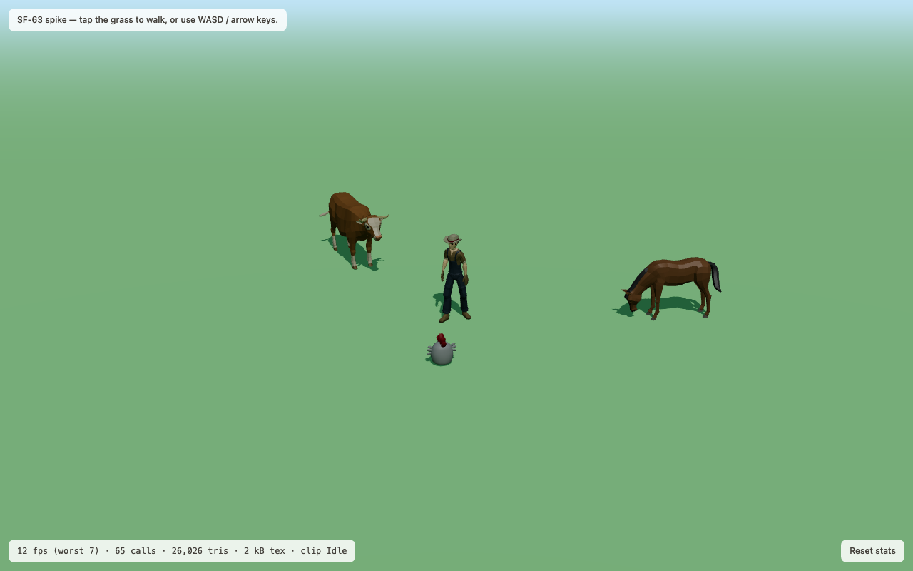
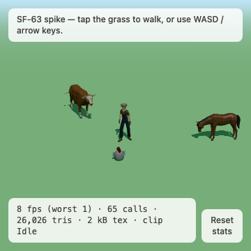

# ADR-0003: Asset pack — Synty SIMPLE for the farm, Quaternius as the free fallback

- **Status:** proposed
- **Date:** 2026-09-08
- **Deciders:** James (sole developer) — this one needs his call, because the
  recommendation costs money and art-direction §9 Q1 already reserved it for him.
- **Ticket:** SF-64 "Spike: asset pack decision"

## Context

Art-direction §7 compares Kenney, Synty POLYGON and Quaternius and recommends
**"Quaternius as the single pack, Mixamo for the keeper's clips"**. That was a
paper comparison. SF-63's spike put the candidates in the actual engine at the
actual camera, and three of the assumptions behind that recommendation turn out
to be wrong. The evidence is in ADR-0004 and in the screenshots below; this ADR
records what the packs actually contain, what they actually cost, and what their
licences actually say as of 2026-09-08.

Three constraints do the deciding:

- **§8, one pack only.** Mixing sources is banned, so a pack has to cover the
  whole farm — the seven species in the implementation plan (chicken, cow, pig,
  sheep, horse, plus the petting-zoo animals) *and* a humanoid keeper — in one
  style.
- **§3, readable silhouette at 64 px.** A six-year-old on a 360-px phone has to
  tell a cow from a horse. That rules out thin legs and small heads.
- **glTF, rigged, with idle + walk.** ADR-0001 committed to buying pre-animated
  assets precisely so we author no animation.

## What the packs actually are

Measured or quoted on 2026-09-08. "Verified" means the file was downloaded and
inspected, not read about.

| | Kenney | Quaternius | Synty POLYGON Farm | Synty SIMPLE (Farm Animals + People) |
| --- | --- | --- | --- | --- |
| **Farm animals, 3D** | **none.** [Animal Pack](https://kenney.nl/assets/animal-pack) and [Animal Pack Redux](https://opengameart.org/content/animal-pack-redux) are **2D** — "Separate PNG files (250×), Spritesheet(s), Vector file(s)" | fragmented across two packs and two styles (below) | **none** — the [store page](https://syntystore.com/products/polygon-farm-pack) lists buildings ×15, props ×165, plants ×173, environment ×67, characters ×6, vehicles ×11, and no animals | 23 models / 10 species: "Pig (x1), Sheep (x2), Cow (x2), Bull (x2), Horse (x5), Chicken (x2), Rooster (x2), Chick (x1), Duck (x3), Goat (x2)" |
| **Humanoid keeper** | `characterMedium.fbx`, 4 skins (human m/f, zombie m/f) — verified | "Farmer" in Ultimate Modular Men, 11 characters — verified | 6 rigged characters (farmer, farm boy) | SIMPLE People: 17 characters × 3 variations, ~300 tris |
| **Rigged + animated** | character yes, **animals n/a**. Clips are **separate FBX files** — `Animations/{idle,jump,run}.fbx` — and there is **no walk** | yes: cow/horse 13 clips (Idle, Walk, Eating, Gallop…), Farmer 24 clips (Idle, Walk, Run, Wave, Interact) — verified | characters rigged but **"set up with Mecanim (no animations included)"** | "Each Animal has an Idle, Walk, Run and Eat animation"; people 16 clips incl. Idle, Walking, Running, Wave |
| **Format** | **FBX only** — verified from the zip | **glTF** + FBX + OBJ + Blend for the two packs used; Farm Animal Pack is FBX/OBJ/Blend only, **no glTF** — verified | "Unity 2022.3 package", "Unreal 4.25 project", "Godot 4.6.2 project", "FBX Source Files" | Unity package + **FBX source files** |
| **Licence** | CC0 1.0. From the pack's own `License.txt`: *"You can use this content for personal, educational, and commercial purposes. Support by crediting 'Kenney' or 'www.kenney.nl' (this is not a requirement)"* — [licence](http://creativecommons.org/publicdomain/zero/1.0/) | **contested — see below** | [One-Time Purchase Licence](https://syntystore.com/pages/one-time-purchase-licence) | same One-Time Purchase Licence |
| **Cost** | $0 | $0 | **$49.99 USD** | **$19.99 + $19.99 = $39.98 USD** one-time (or [SyntyPass](https://syntystore.com/products/syntypass) from $30/mo) |
| **Style fit vs §3** | generic blocky; animals do not exist in 3D | **fails** — see the render | cohesive but adult-proportioned | closest match on the store previews: chunky, flat-shaded, stub limbs — **not verified in engine, the pack is paid** |
| **Redistribution** | none. Public domain | may not redistribute *as assets*; shipping inside a Product is explicit | 5 seats per licence; "You must not share the source files of any Assets outside your team"; "you must not distribute our Assets as stock images or stock art (2D or 3D) or otherwise share them for re-use by third parties" | same |
| **Attribution** | not required | not required | not required | not required |

### Quaternius is two different packs in two different styles

- **Ultimate Animated Animal Pack** (July 2021) — 12 models, verified by
  download: Alpaca, Bull, Cow, Deer, Donkey, Fox, Horse, Horse_White, Husky,
  ShibaInu, Stag, Wolf. **No chicken, no pig, no sheep.**
- **Farm Animal Pack** (June 2018) — 7 models, verified: Cow, Horse, Pig,
  Sheep, Llama, Pug, Zebra. **No chicken**, and **no glTF export** (FBX / OBJ /
  Blend only), so it needs a Blender round-trip.
- Both are naturalistic low-poly: thin legs, small heads. The spike render below
  is what that looks like at the §2 camera.
- A **chunky, big-headed** Quaternius chicken does exist (CC0, animated, 2,904
  tris, 4 bones, Idle/Walk/Dance clips — verified by download from
  <https://poly.pizza/m/ineV9pU5VL>), and it is the style §3 describes. It is in
  **no pack listed on quaternius.com**. So Quaternius cannot supply one coherent
  farm under the §8 one-pack rule; it supplies two half-farms in two styles.

### The Quaternius licence changed under us

Every pack page still shows a **CC0** badge linking
<https://creativecommons.org/publicdomain/zero/1.0/>. The site-wide licence page
<https://quaternius.com/license.html>, **last updated 2026-08-28**, now publishes
the **Quaternius Asset Licence (QAL) v1.0** instead:

> §2 … "Use, copy, and modify the Assets; Incorporate the Assets (in original or
> modified form) into a Product; Publish, distribute, sell, sublicense, and
> otherwise commercially exploit that Product, without owing us any fee,
> royalty, or credit … No attribution is required."
>
> §3(a) "You may not extract, repackage, sublicense, sell, or otherwise
> redistribute the Assets (in original or modified form) as a standalone asset,
> asset pack, stock file, template, or similar product … It does not restrict
> distributing a completed Product that merely incorporates the Assets."
>
> §7 "Changes will not apply retroactively to Assets you've already obtained
> under an earlier version."

For the game itself this is harmless: shipping `.glb` files inside a web build is
a Product, explicitly allowed by §2/§3(a). The part to be careful about is
committing loose `.glb` files to a repo — fine while `jhoffman-dev/sanctuary-farm`
is private, worth a second look if it is ever made public. Two statements
disagreeing on the same site is itself a small risk: a free pack whose terms move
is a dependency we do not control.

### Mixamo

**Not evaluated.** Mixamo requires an Adobe sign-in, which an agent cannot
complete, so no clip was downloaded or retargeted. The spike therefore used
characters that already carry idle + walk. What Mixamo would add is breadth —
`carry`, `pet`, `dance` from art-direction §8 — retargeted onto whatever
humanoid we pick. What it costs is a Blender FBX→glTF step per clip and
foot-slide QA on chunky proportions. Both Quaternius' Farmer (24 clips) and
Synty SIMPLE People (16 clips) already cover idle/walk/run/wave without it, so
Mixamo is a Phase 3 nicety, not a dependency.

## Decision

**Buy Synty SIMPLE Farm Animals + SIMPLE People — US$39.98 one-time, 5 seats —
and make the SIMPLE line the single pack.** Keep Quaternius (Ultimate Animated
Animal Pack + Ultimate Modular Men) as the zero-cost fallback and as the source
for anything SIMPLE lacks.

The deciding reason is coverage, not taste: **no free option has a rigged,
animated chicken in the same style as its cow**, and the nest hollow, the eggs
and the hatch ceremony are the core loop, not decoration. Kenney has no 3D
animals at all. POLYGON Farm has no animals and no animations. Quaternius has
two styles and no chicken in either pack. SIMPLE Farm Animals has all seven
species plus ducks and goats, each with Idle/Walk/Run/Eat, and SIMPLE People
gives the keeper the same look for another $19.99.

$39.98 is inside the "≈ US$50" that art-direction §9 Q1 already put to James, and
it is a third of the POLYGON price for the thing we actually need.

## Alternatives considered

- **Quaternius alone (the art-direction recommendation).** Free, CC0-badged,
  ships glTF, genuinely good rigs. Rejected on the two spike checks: the
  animals fail §3 at 64 px (see ADR-0004), and no single pack covers the farm —
  taking the chunky chicken *and* the naturalistic cow breaks §8 in the first
  week. Still the fallback if James declines the purchase; in that case §3 has
  to be relaxed to "naturalistic low-poly" and the chicken sourced separately.
- **Kenney alone.** Free and permissive, but there are no 3D farm animals to
  have, the character ships FBX-only with animations in separate files and no
  walk cycle, and a whole Blender merge-and-export pipeline would buy us a
  smaller move set than either alternative.
- **Synty POLYGON Farm ($49.99).** More money for buildings and props we can
  model ourselves, no animals, and no animations on the characters. The pack
  art-direction §7 singled out is the weakest fit of the four.
- **SyntyPass ($30/month).** Cheaper only if we keep buying; a recurring cost on
  a free, no-revenue project is the wrong shape. Two one-time packs is $39.98
  once.
- **Mixing Quaternius animals with a Synty keeper.** Banned by §8, and the
  spike's cow-and-chicken frame shows why: two low-poly styles side by side
  read as a bug.

## Consequences

- **Positive:** one style for every species the game names, idle/walk/run/eat on
  every animal, a matching keeper, and no animation authoring. Attribution is
  not required, so no credits burden. 5 seats covers James plus any future help.
- **Cost:** US$39.98, one time. A Blender FBX→glTF conversion step we do not
  need with Quaternius (Synty ships FBX source, no glTF) — one-off per model,
  scriptable, and ADR-0004 already specifies the `gltf-transform` half of that
  pipeline.
- **Risk — the EULA and a public web build.** A shipped web game serves its
  `.glb` files to the browser, so anyone can save them. That is incorporation
  into a Product (permitted), not distribution "as stock art" (forbidden), but
  the EULA has no clause about extraction from a shipped build, and Synty's FAQ
  reserves a custom licence for some distribution platforms. **Committing Synty
  source files to the repo is the part to avoid** — the repo would have to keep
  only built `.glb`s, or stay private. Flagged as open question 1.
- **Risk — style unverified in engine.** The SIMPLE line was judged from store
  previews only; the pack is paid and could not be downloaded. First job after
  purchase is to redo ADR-0004's 64-px silhouette test on real SIMPLE models
  before any world-building depends on them.
- **Follow-ups:** the asset pipeline ticket (FBX → glTF → `gltf-transform` →
  `public/models/`), the clip-renaming step (§8 wants `idle`/`walk`/`eat`; all
  three candidates use their own names), and the face-kit ticket from §3.

## What would change this decision

1. **James declines the spend or the EULA.** Then it is Quaternius, and
   art-direction §3 must be rewritten to the naturalistic style the spike
   rendered — with the chicken as a known gap.
2. **The SIMPLE models fail the 64-px test on inspection.** Then no candidate
   satisfies §3 and the honest answer is to commission or model the farm animals
   ourselves in Blender, which is the only path that guarantees the silhouette.
3. **Quaternius publishes one coherent chunky farm pack.** It is an active
   catalogue; a single pack with chicken + cow + pig + sheep + a humanoid in the
   big-head style would beat a paid pack on every axis except the licence
   stability question.
4. **The repo goes public.** That sharpens the Synty source-file question and
   would also want a second look at QAL §3(a).

## Evidence

Screenshots from the SF-63 spike, all at the art-direction §2 camera. Full
numbers in ADR-0004.

Quaternius' naturalistic cow and horse with the chunky chicken between them —
the two styles that cannot share a farm. The chicken renders grey because the
poly.pizza mirror's conversion mangled its base colours; see
`apps/web/public/spike/LICENSES.md`.

The §3 test. At 65 px the cow and the horse are the same brown quadruped, and
the chicken (32 px) is a dot. Thin legs and small heads are what fail here.
