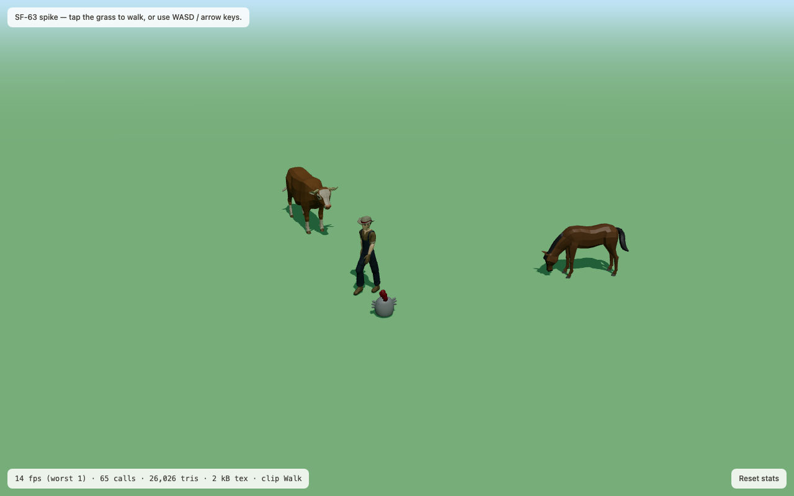
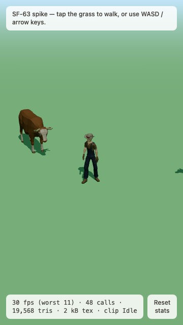

# ADR-0004: 3D foundation — AnimationMixer crossfade, tap-to-move, fixed camera

- **Status:** proposed
- **Date:** 2026-09-08
- **Deciders:** James
- **Ticket:** SF-63 "Spike: r3f character controller"

> **Update 2026-10-11 — ADR-0006 (Godot).** The game moved to Godot 4.7, so
> the **r3f specifics here no longer apply** to it: `AnimationMixer` /
> `crossFadeTo`, r3f pointer events, `renderer.info`, the jsdom/WebGL test
> carve-out and the three.js loader wiring. Godot's `AnimationPlayer` /
> `AnimationTree` and its editor take their place. **What stands:** Kenney
> GLBs loaded as shipped (ADR-0003 addendum — no meshopt or other conversion),
> clips chosen by name (`idle`, `walk`, …) from velocity, art-direction §2's
> fixed camera numbers as the starting point (the Godot skeleton uses them),
> and the measured lesson that draw calls bite before triangles. Note for
> Godot: the Kenney GLBs face +Z on import, so they need **no** 180° turn to
> face the §2 camera (the r3f catalogue's `quarterTurns: 2` does not carry
> over).

## Context

ADR-0001 chose react-three-fiber over Unity and named the cost plainly: *"no
Animator state machine, no humanoid retargeting"*. SF-63 was the timeboxed
check that the cost is small — that a rigged glTF, an idle↔walk crossfade, a
tap-to-move controller and the art-direction §2 camera add up to something a
six-year-old would accept, inside `performance-budget.md`.

The spike lives on `spike/SF-63-64-3d-foundation` at `?spike=3d`. It is
**throwaway** and will not merge: `apps/web/src/spike/` holds no game rules and
imports nothing from `@sf/domain` or `@sf/application`.

## What was built

- Three rigged, animated Quaternius glTFs (keeper, cow, horse) plus a chicken
  from Quaternius' other line, meshopt-compressed to `.glb`.
- A **fixed camera** at art-direction §2's numbers — `[9, 7, 12]` → `[0, 0.6, 0]`,
  FOV 35 — with no orbit and no sway.
- **Tap-to-move**: an r3f `onPointerDown` on the ground plane, `event.point` as
  the target, the keeper walking to it and turning to face its own velocity.
- **Keyboard fallback**: WASD / arrows, screen-relative (rotated into world
  space by the camera's ground yaw, or "up" walks diagonally on an isometric
  view). Keys override a tap mid-walk; a window blur clears held keys.
- **Idle ↔ walk crossfade** driven by the keeper's own speed.
- A measurement overlay that publishes `renderer.info`, the frame clock and each
  model's on-screen height onto the DOM at 5 Hz, which is how the Playwright
  spec reads a WebGL scene.

Verified by `apps/web/e2e/spike-3d.spec.ts` — 7 tests, all green in headless
Chromium: the scene renders; a click walks the keeper (position changes by >1
unit) and the clip goes Idle → Walk → Idle; the keyboard does the same without a
pointer; and the numbers below are recorded at each viewport.

## What worked

**The crossfade.** `AnimationMixer` + `action.crossFadeTo(next, 0.25, false)`,
with one active action and a `fadeTo` that is a no-op when the name has not
changed, so the controller can call it every frame. Roughly forty lines in
`clip-crossfade.ts`. `warp: false` matters — warping a 24-frame walk into an
idle's timing reads as a stumble. This is the whole of the "Animator state
machine" ADR-0001 worried about; for a farm move set (idle, walk, carry, pet,
dance) a single active action plus a fade is enough, and a full state machine
would be over-engineering.

**Speed as the blend input.** `clipForSpeed(speed, 0.05)` — one threshold, not a
blend tree. Below 0.05 m/s the walk cycle foot-slides, so it reads as standing.
Because the *velocity* decides the clip and not the input, tap-to-move and
keyboard produce identical animation with no extra code.

**The camera rig.** The §2 numbers hold up: roofs and faces both readable, the
keeper at 139 px on a 1280×800 window. Nothing needed tuning. The only change
from `FarmScene.tsx` was widening the ground plane to 200 units so its edge does
not show as a horizon through the fog.

**Separating the maths from the rendering.** `steering.ts`, `model-fit.ts`,
`frame-stats.ts`, `texture-memory.ts`, `screen-size.ts` and `spike-session.ts`
are pure and unit-tested (33 tests); the r3f components are covered by the
Playwright spec because jsdom has no WebGL context. Phase 2 can keep the pure
half verbatim and rewrite the components. That split is the recommendation as
much as anything else here.

**The asset pipeline.** `gltf-transform optimize --compress meshopt` took the
three Quaternius `.gltf` files from 3.0–3.6 MB to 169–249 kB — a **93 % cut** —
after dropping the clips we do not play (Quaternius ships 13–24 per model,
mostly combat). Its `palette` pass folded 8 flat materials into 1 material plus
a tiny palette texture, which is exactly the "one palette atlas" art-direction
§3 asks for, for free.

## What did not

**Mixamo was not used.** It requires an Adobe sign-in that an agent cannot
complete. No clip was downloaded and none was retargeted, so the ticket's
"crossfade a Mixamo clip" is **unanswered**. The spike used Quaternius
characters that already carry idle + walk, which is why the crossfade question
still got a real answer. What Mixamo would add is the wider move set (`carry`,
`pet`, `dance`); what it costs is an FBX→glTF step per clip and foot-slide QA on
chunky proportions. Nothing in this ADR depends on it.

**Quaternius' animals fail the §3 silhouette test.** This is the spike's most
consequential finding and it belongs to ADR-0003, but the measurement is here:
shrunk until the cow lands on 65 px, the cow and the horse are the same brown
quadruped and the chicken is a 32-px dot. Thin legs and small heads are exactly
what §3 forbids, and art-direction §7's "chunky low-poly, big heads; closest to
§3 out of the box" describes a *different* Quaternius line.

**Portrait framing is broken.** At 360 × 640, FOV 35 vertical gives a horizontal
FOV so narrow that the horse leaves the frame entirely (see the screenshot). That
answers art-direction §9 Q3 with evidence: either the alpha is landscape-only,
or the camera pulls back / widens FOV on portrait aspect ratios. A Phase 2
camera ticket has to decide.

**Three clip-naming conventions in one vendor.** `Idle`/`Walk`/`Eating` on the
animals, `Idle`/`Walk`/`Wave` on the keeper, `CharacterArmature|Idle` on the
chunky line. Art-direction §8 wants `idle`/`walk`/`eat`, so the asset pipeline
needs a rename pass; the spike worked around it by taking clip names as props.

**A third-party glTF mirror is not a source.** The chicken came from
poly.pizza's conversion of a Quaternius model; its base colours came out mid-grey
(`baseColorFactor` 0.289 linear where the vendor's own render is white) and its
`metallicFactor` was 0.4 — near-black in a scene with one directional light and
no environment map. **Rule for the pipeline: take glTF from the vendor, and
normalise `metallicFactor` to 0 for a flat-shaded pack.**

## Measured, against `performance-budget.md`

Headless Chromium (Playwright, Chrome 141-class, Apple Silicon), production
build via `vite preview`, 5-second window after a stats reset. Four skinned
characters, one directional shadow, one hemisphere light.

| Line | 1280 × 800 | 360 × 640 | Budget (target / ceiling) | Verdict |
| --- | --- | --- | --- | --- |
| Draw calls | **65** | 58 | 100 / 150 | inside, but see below |
| Triangles on screen | **26,026** | 25,376 | 150 k / 250 k | comfortably inside |
| — of which geometry | 13,012 (keeper 5,476 · chicken 2,904 · cow 2,450 · horse 2,182) | same | — | the shadow pass renders every caster a second time |
| Unique materials | 4 programs, 1 material per model after `palette` | same | 12 / 20 | inside |
| GPU texture memory | **2 kB** (4 palette textures) | 2 kB | 96 MB / 128 MB | not a constraint for untextured packs |
| Skinned meshes on screen | **7** (the keeper is 4) | 7 | 6 / 8 | **at the ceiling with one keeper and three animals** |
| Bones per rig | keeper 62, cow 42, horse 50, chicken 4 | — | ≤ 64 | inside, keeper with 2 to spare |
| First rendered frame | **507 ms** | 493 ms | — | on a fast machine, warm cache |
| Sustained FPS | **40.4** avg, worst frame 30.3 | **60.0** avg, worst 44.6 | 60 / floor 30, 1 % low ≥ 24 | see below |

Bundle delta, measured by building `origin/main`'s `main.tsx` against the
spike's:

| | Baseline (main) | With the spike | Delta |
| --- | --- | --- | --- |
| `index` chunk | 1,097.63 kB raw / **303.17 kB gz** | 1,101.56 kB / **304.75 kB gz** | +3.93 kB / **+1.58 kB gz** (the lazy wiring) |
| `SpikePage` chunk | — | 79.97 kB / **24.25 kB gz** | new, lazy |
| Models on disk | — | 645 kB total (`keeper` 249 + `horse` 186 + `cow` 169 + `chicken` 41) | vs the 1.5 MB / 2.5 MB first-hotspot budget |

**Read these numbers carefully.** They are not a device run. The reference
Chromebook (SF-34, still unprovided) is the budget's actual bar, and it is
perhaps 5–10× slower on GPU than this machine. Three things they do say:

1. **Triangles and texture memory are not the constraint.** 26 k triangles
   against a 150 k target, and 2 kB of texture. A flat-shaded pack with one
   palette texture per model spends nothing here.
2. **Draw calls are the thing to watch.** 65 = 32 skinned primitives × 2 (colour
   pass + shadow pass) + the ground. Every primitive is its own call, and the
   keeper alone is 12 of them. Four more animals and the barn would pass 100.
   `gltf-transform join` cannot merge skinned primitives ("Instancing is not
   currently supported for animated models"), so the fix is either fewer
   material slots per model or shadow casters limited to the keeper and the
   nearest animals.
3. **The 1280 × 800 average of 40 fps is capped, not slow** — the worst frame
   was 30 fps at 1280 × 800 and 45 fps at 360 × 640, and the smaller viewport hit
   a clean 60. The scene is fill-rate bound (one full-screen ground plane, one
   1024² shadow map), which is precisely what the budget's DPR cap of 1.5 and
   `frameloop="demand"` are for — neither is implemented yet.

The 360 × 360 silhouette run recorded 16.6 fps: that test screenshots after ~1 s
and its window is dominated by load, so it is not a runtime reading.

## Decision

Adopt the spike's approach for the Phase 2 3D foundation:

1. **Animation: `AnimationMixer` + `crossFadeTo`**, one active action per
   character, clip chosen from velocity by a pure function. No blend tree, no
   third-party state-machine library.
2. **Movement: tap-to-move on the ground plane**, with a screen-relative
   keyboard fallback that overrides a tap. Velocity is the single source of
   truth for facing and for the clip.
3. **Camera: the §2 numbers, fixed**, ground plane wider than the fog is deep.
   Portrait framing is an open ticket, not a solved problem.
4. **Structure: pure controller, thin components.** `steering`-style modules
   with unit tests; r3f components excluded from coverage and covered by
   Playwright, because jsdom has no WebGL context. (On the spike branch that
   exclusion and its reason are in `vitest.config.ts`; Phase 2 will need the
   same carve-out for `apps/web/src/scene/`.)
5. **Assets: `gltf-transform optimize --compress meshopt`** with clips trimmed
   first, `metallicFactor` normalised to 0, clip names normalised to §8's, and
   the loader wired with `setMeshoptDecoder`.

## Pathfinding — what Phase 2/3 actually needs

The spike walks in a straight line to the tapped point. That is enough for one
flat field and not enough for the farm:

- **Phase 2 (one contiguous farm, seven hotspots).** Straight-line steering plus
  **static circle/box obstacle avoidance** — barn, feed shed, pond, fences — is
  probably sufficient, because the farm is convex-ish and the hotspots are on
  open ground. Cheapest honest version: keep the tap target, and clamp the path
  out of a small list of blocking volumes.
- **Phase 3 (hotspot interiors, the paddock, the training ring).** Once the
  keeper has to walk *around* the barn to reach the nest hollow, straight-line
  steering visibly fails. The answer is a **baked navmesh** — author it in
  Blender alongside the farm layout and run [recast-navigation-js](https://github.com/isaac-mason/recast-navigation-js)
  (or `three-pathfinding` on a hand-authored nav-grid, which is lighter) at
  runtime. Both are additive: the controller's contract stays "give me a target,
  I produce a velocity", and only the path between target and velocity changes.
- **What not to do:** a physics engine. Nothing in the farm needs dynamics, and
  Rapier or Cannon would cost more bundle than the whole world chunk budget.

## Consequences

- **Positive:** ADR-0001's biggest named risk is retired — the animation and
  controller work is small, and the pure half is testable without a GPU. The
  asset pipeline is a one-line `gltf-transform` invocation with a 93 % saving.
- **Cost:** the world chunk carries GLTFLoader + the meshopt decoder + the
  controller — **24.25 kB gz** measured, inside the 250/350 kB gz world budget
  with three.js. Draw calls, not triangles, will be the budget we hit first.
- **Negative / unresolved:** no device run (SF-34), no Mixamo, no portrait
  answer, and the chosen asset pack is now ADR-0003's problem rather than a
  settled input. *(2026-10-07: settled — ADR-0003 accepted Kenney.)*
- **Follow-ups:** the pathfinding ticket above; the camera/portrait ticket; a
  draw-call ticket (shadow-caster culling, fewer material slots); and the
  performance-budget items that are still not implemented — DPR cap 1.5,
  `frameloop="demand"`, the quality-tier probe, `size-limit`, Lighthouse CI.

## Open questions

1. **Which device is the reference (SF-34)?** Every number above is from a fast
   laptop. 40 fps here could be 8 fps on an N4000, or fine — nobody knows, and
   the budget cannot be signed off until someone measures.
2. **Landscape only, or does portrait have to frame the farm?** The 360 × 640
   screenshot loses the horse off the right edge. This changes the camera rig,
   so it wants answering before the rig is built.
3. **Do we need a navmesh in Phase 2, or can obstacle avoidance carry it?** That
   depends on the farm layout, which does not exist yet.
4. **Shadows: one 1024² map for every caster, or keeper-only?** It is roughly
   half the draw calls. A farm where only the keeper casts a shadow may look
   fine and may not.

## Evidence

Keeper, cow, horse and chicken at the §2 camera; the overlay is the measurement
surface the Playwright spec reads.

Mid-walk after a tap at the lower left: the walk clip is playing and the keeper
has turned to face its velocity.

Portrait: 60 fps, but the horse is outside the frame.

The §3 silhouette test, shrunk until the cow measures 65 px.
