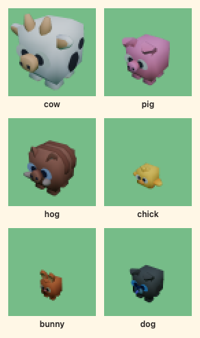
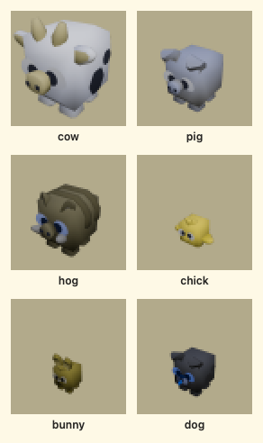

# Art direction

The look of Sanctuary Farm, and the rules that keep it coherent as agents add
art. The asset pack itself is **not decided here** — that is the Phase 2 ADR
(ticket "Spike: asset pack decision"). This doc sets the direction and compares
the candidates so that ADR can be short. Accessibility bounds come from
`accessibility.md`; texture and triangle limits from `performance-budget.md`.

## 1. The feeling

Cosy, safe, unhurried. Animal Crossing / Stardew warmth without their clutter —
a small, tidy farm with room to breathe, where nothing flashes and nothing is
in a hurry. The farm is a place a kid wants to return to tomorrow, not a reward
screen bolted onto a quiz.

## 2. Camera and world

Fixed three-quarter view from a little above, no free orbit. The numbers match
`packages/world/layouts/farm.json` (`camera.home`) and
`apps/web/src/scene/camera-views.ts`, and are the starting point for the Phase 2
camera-rig ticket, not a contract.

| Setting | Value | Why |
| --- | --- | --- |
| Position / look-at | `[13, 12.5, 18.5]` → `[0, 0.6, 1]` (≈ 29° elevation, ≈ 37° azimuth, 24.9 units out) | The "storybook" angle, pulled back (SF-75) so all seven hotspots are in frame at 1280 × 800; the alpha's `[9, 7, 12]` → `[0, 0.6, 0]` (23°, 16.6 out) framed only the middle of the 30 × 30 farm |
| FOV | 35° vertical | Mild perspective; near and far animals stay the same shape |
| Tunable range | elevation 20–35°, FOV 30–40° | Beyond this it reads as top-down or as first-person |
| Motion | sway ≤ 0.35 m at ≤ 0.15 rad/s; game-initiated moves ≤ 1.5 s eased; **none** under reduced motion | `accessibility.md` §3 |
| Framing | camera pans to follow the keeper with a wide dead zone; hotspot scenes re-frame by a single eased move, never a cut | Gentle; the world never lurches on an answer |

**One contiguous farm** (~30 × 30 units walkable, crossing ≤ 8 s) with the seven
hotspots from the implementation plan: barn, feed shed, nest hollow, paddock, training ring,
pond + petting zoo, farmhouse. Fog in the sky colour hides the edge.

**Scale rule.** 1 unit = 1 m. Keeper 1.6 units, chunky (~3 heads tall). Chicken
0.5, sheep / pig / hog 0.9, cow 1.3; the catalogue's bunny 0.6 and dog 0.67 (the
dog under 0.69 so size parts it from the pigs — §3); barn ≈ 3 × 2.5 × 3.3. The
hog matches the pig rather than towering over it: Kenney's hog is a pig in another
colour, and colour, not size, tells the two apart. At the alpha camera the
keeper is ≈ 165 px tall at 1080p and ≈ 100 px on a 640-px phone, so animals land
at 50–130 px — nothing the kid must recognise is under 0.5 units. The SF-75 home
camera is 1.5× further out, so until the camera rig follows the keeper and
re-frames each hotspot (its `cameraAnchor`), the keeper is ≈ 110 px at 1080p and
the chick ≈ 35 px — legibility is the rig ticket's job to win back.

## 3. Shape language

- **Identifiable at 64 px by colour, size and shape together.** 64 px is the
  rendered size on the smallest supported device. Pass criterion: a child can
  name each animal and hotspot from a 64-px **colour** render. Each species has
  a distinct body colour (§4) that stays apart under deuteranopia, protanopia
  and tritanopia simulation, keeps its §2 size, and keeps its distinguishing
  features chunky (cow horns, pig snout). This replaced the shape-only
  black-silhouette rule, which Kenney's cube animals fail (ADR-0003).

  **The rule, as tested** (`apps/web/src/world-assets/animal-identification.test.ts`):
  every pair of animals differs in dominant body colour by **ΔE00 ≥ 20** (CIEDE2000,
  on the albedo drawn — atlas texel × tint) for normal vision **and** each
  dichromacy (Machado 2009, severity 1), **or** in height by **≥ 30 %**. Why 20:
  Kenney paints one body in shades up to 7–15 apart (the hog's most), so a pair
  must sit clear of the spread inside any one animal to read as two colours, not
  as light and shade; at 10 the pig and Kenney's untinted hog (9.7 under
  tritanopia) would nearly pass, and they are the pair that shares a pen. The e2e
  `apps/web/e2e/animal-identification.dev.spec.ts` renders each animal alone at
  the game camera's angle, shrinks it to 64 × 64 on a 360 × 640 screen, re-checks
  the size order and the colours actually drawn, and saves the sheets below.

  | pair | normal | deutan | protan | tritan | height ratio | parted by |
  | --- | --- | --- | --- | --- | --- | --- |
  | cow / pig | 25.7 | 12.8 | 17.4 | 27.0 | 1.44 | size |
  | cow / hog | 39.6 | 37.9 | 40.2 | 41.4 | 1.44 | both |
  | cow / chick | 32.5 | 32.8 | 33.5 | 23.9 | 2.60 | both |
  | cow / bunny | 39.7 | 38.6 | 42.3 | 39.1 | 2.17 | both |
  | cow / dog | 45.0 | 44.9 | 44.8 | 44.7 | 1.94 | both |
  | pig / hog | 27.4 | 25.8 | 29.0 | 22.4 | 1.00 | colour |
  | pig / chick | 45.5 | 30.1 | 39.7 | 11.2 | 1.80 | size |
  | pig / bunny | 31.1 | 27.7 | 35.1 | 17.2 | 1.50 | size |
  | pig / dog | 38.5 | 33.6 | 30.0 | 36.6 | 1.34 | both |
  | hog / chick | 39.1 | 35.1 | 37.1 | 29.7 | 1.80 | both |
  | hog / bunny | 12.0 | 12.0 | 11.1 | 9.1 | 1.50 | size |
  | hog / dog | 21.8 | 16.8 | 11.8 | 22.2 | 1.34 | size |
  | chick / bunny | 31.6 | 25.7 | 29.7 | 25.1 | 1.20 | colour |
  | chick / dog | 49.9 | 51.0 | 48.0 | 47.0 | 1.34 | both |
  | bunny / dog | 28.8 | 27.9 | 22.2 | 30.9 | 1.12 | colour |

  
  
- **Rounded and chunky.** No thin details: no fence wire, no whiskers, no
  spindly legs. Legs and ears are stubs; roofs, troughs and eggs are fat.
- **Low-poly, flat-shaded, palette-atlas textured** (not soft-textured). Why:
  it reads at small sizes, the whole scene fits one 1024² colour atlas (tiny
  texture memory, no filtering shimmer on low-end GPUs), all three candidate
  packs share it, and colours can be re-tuned centrally for colour-blindness.
- **Animals: big head, simple eyes, one body colour plus one marking.** The
  prototype's eye styles — `big / sleepy / sparkly / wide` — stay as the
  personality axis: one eye style per animal, authored by us as a swappable face
  kit (flat eye meshes in Blender) applied on top of whichever pack we pick.
- **Mood is posture and face**, never colour: content = head up, ears up, eyes
  open; glum = head low, ears down, half-lidded eyes. Never desaturated, never
  "sick", never a sad-face sprite over a grey animal (design rule 6).

## 4. Palette

Warm, mid-saturation, no neon. Named tokens, one source of truth (a Tailwind
theme file **and** the 3D palette atlas are generated from the same list).

| Token | Hex | Used for |
| --- | --- | --- |
| grass | `#8FD18A` | ground (matches `FarmScene.tsx`) |
| grass-shade | `#5FA85E` | grass in shadow, hedges |
| soil | `#A8734B` | paths, stall floor, dirty patches |
| wood | `#C08A4E` | fences, trough, feed shed |
| wood-dark | `#7A3B2E` | barn roof, beams |
| barn | `#C8553D` | barn walls (the one strong red; never a state colour) |
| sky | `#BFE3F5` | background + fog |
| water | `#6FB7D6` | pond, trough water |
| straw | `#E9C46A` | straw, eggs, hay bales |
| **marigold** | `#F4A340` | UI accent 1: primary action (ink text on it, 6.9:1) |
| **pond-teal** | `#1F7A6F` | UI accent 2: progress, "fluent" (white on it, 5.2:1) |
| **plum** | `#5B4B8A` | UI accent 3: focus ring, secondary (white on it, 7.5:1) |
| cream | `#FFF7E6` | cards, pad keys |
| ink | `#2F2A26` | all text (13.3:1 on cream) |

**Animal body colours** (§3). Kenney's atlas colour unless a tint is listed; a
tint is multiplied into the GLB's material when it loads (`kenney-catalogue.ts`),
so the files stay unmodified (ADR-0003). A multiply can only darken a texel.

| Species | Body (as drawn) | Tint | Why |
| --- | --- | --- | --- |
| cow | `#dcdce9` white | — | |
| pig | `#e38cb2` pink | — | |
| hog | `#8e5f54` boar brown | `#b3ccff` | Kenney's hog brown is 9.7 from the pig under tritanopia |
| chick | `#ffc256` yellow | — | |
| bunny | `#b2633b` rust | `#d9ccb3` | Kenney's bunny brown is 16 from the chick under tritanopia, at nearly its size |
| dog | `#525557` slate | `#66b3ff` | Kenney's dog is the bunny's brown (ΔE 0.5) at nearly its size |

A tint also colours the whites of the eyes (the hog's and the dog's read pale
blue); a body-only recolour would need a shader, not a tint.

Rules that constrain it (`accessibility.md` §2):

- Text ≥ 4.5:1, icons / borders / meters ≥ 3:1 — always measured on the card
  the text sits on. **Text never sits directly on the canvas.**
- Feedback is never colour-only: every outcome is glyph + words; every meter has
  a number. Red ↔ green, green ↔ brown, blue ↔ purple, amber ↔ green never carry
  meaning alone — the farm is green and amber by nature, so these are exactly
  the pairs we would otherwise reach for.
- Animal health: a labelled meter in the HUD plus posture in the world (§3).

## 5. Lighting and time

| Light | Value | Notes |
| --- | --- | --- |
| Key | one warm directional, intensity ≈ 1.3 from `[6, 12, 5]`, 1024² shadow map; colour `#FFF1D6` proposed | Position, intensity and shadow map as in `FarmScene.tsx` (which still uses default white); the only shadow caster |
| Ambient | hemisphere, sky `#BFE3F5` over ground `#8FD18A`, ≈ 0.75 | Soft; lifts shadows so faces read |
| Rim | subtle, baked into the material (fresnel / matcap), **not** a second light | Separates animals from grass at no draw cost |

**No real-time day/night cycle in the alpha.** Readability: a dusk scene drops
grass and animal contrast below what §3 needs; performance: moving shadows and
changing exposure cost frames on the oldest device for no learning value. The
one time-of-day change is **goodnight**: sky → `#F5C6A0`, key → `#FFB27A`,
eased ≤ 1.5 s (crossfade ≤ 200 ms under reduced motion), then the goodnight
card. Nothing else in the world changes with the clock.

## 6. UI overlay

Tailwind 2D DOM overlay over the canvas; everything the kid must read or act on
lives here (`accessibility.md` §3).

- **Cards:** cream, `rounded-2xl`, 2 px `wood` border, soft single shadow; one
  card per concern (question, pad, HUD, feedback). Never translucent over grass.
- **Type:** display **Fredoka** (headings, the question, pad keys, every HUD
  number); body **system-ui** stack (`system-ui, -apple-system, Segoe UI, Roboto,
  sans-serif`). Self-host the one display file under `apps/web/public/fonts/`
  — no runtime request to a font CDN. Fallback display font if Fredoka fails
  the numeral test: **Nunito**.
- **Numerals must be unambiguous:** flagged `1` vs plain `7`, open-tailed `6`
  vs `9`, `0` distinct from `O`; `font-variant-numeric: tabular-nums` so the HUD
  never jitters. Verify at 32 px before adopting any font.
- **Sizes:** body ≥ 16 px, question ≥ 32 px, HUD ≥ 14 px, pad keys ≥ 56 × 56 px.
- **Icons paired with text**, always — an icon alone is never a label. One icon
  set, outline style, 2 px stroke, `ink` coloured.

## 7. Asset pack candidates

| | Kenney | Synty POLYGON (Farm) | Quaternius | Mixamo (keeper anim only) |
| --- | --- | --- | --- | --- |
| Style fit | Flat low-poly, clean but generic; little character in faces | Cohesive, stylised, strong character; slightly "adult" proportions | Chunky low-poly, big heads; closest to §3 out of the box | n/a (animation, not models) |
| Animals | Thin: scenery kits are rich, farm animals few — would force a second source | Cow, pig, sheep, chicken, horse + props + buildings + farmer | Farm animals pack: cow, pig, sheep, chicken, horse, … + buildings | none |
| Rigged / animated | Characters yes (basic clips); animals mostly static | Rigged; few animal clips; humanoids Mixamo-compatible | Rigged **and** animated (idle / walk / eat…); humanoid character packs too | Humanoid clips + auto-rigger; retargets onto Synty / Quaternius humanoids |
| Licence | CC0 | Synty EULA: per-seat, no redistribution of raw assets; **confirm web delivery of GLBs is within terms** | CC0 | Free with Adobe ID; use in games OK, no standalone redistribution |
| Cost | $0 | ≈ US$40–60, one seat | $0 | $0 |
| Formats | glTF/GLB, FBX, OBJ | FBX + Unity package → convert in Blender | glTF, FBX, Blend | FBX → GLB via Blender |
| Risk | Style-mixing to get animals | Cost; EULA check; conversion pipeline; fantasy expansion means buying more packs | Fewer scenery props; face expressiveness needs our face kit | Foot-slide on chunky proportions; needs retarget QA |

**Recommendation for the ADR:** Quaternius as the single pack, Mixamo for the
keeper's clips, our own Blender face kit for eyes/mood. It is free, CC0, ships
glTF and animated animals, and its proportions already match §3. Buy Synty
POLYGON Farm only if the spike fails one of the two checks below.

**Phase 2 spike (timeboxed):** load Quaternius cow + chicken + a humanoid in
r3f at the §2 camera; (1) do the animals pass the 64-px silhouette test and take
the face kit cleanly? (2) does a Mixamo idle↔walk crossfade look right on the
keeper at 1.6 units? Measure draw calls and texture memory against
`performance-budget.md`. Screenshots at 1280 × 800 and 360 × 640 go in the ADR.

## 8. Rules for anyone adding art

- **One pack only.** No mixing sources, even for one prop; model a missing prop
  in Blender in the pack's style instead.
- **glTF/GLB only**, Y-up, 1 unit = 1 m, origin at the feet / base, facing −Z.
- Power-of-two textures within `performance-budget.md`: one ≤ 1024² atlas per
  pack, no per-model textures. Draco/meshopt compression on.
- Animation clips baked into the model file, named `idle`, `walk`, `carry`,
  `pet`, `dance` (keeper) and `idle`, `walk`, `eat`, `happy` (animals).
- Location and naming: `apps/web/public/models/<category>/<name>.glb`, kebab-
  case — `animals/cow.glb`, `buildings/barn.glb`, `props/trough.glb`,
  `keeper/keeper.glb`.
- Every asset's source, version, author and licence goes in
  `apps/web/public/models/LICENSES.md` in the same PR that adds it.
- Colours come from the §4 tokens — no ad-hoc hex in components or materials.

## 9. Open questions for James

1. Is a ≈ US$50 Synty purchase acceptable if the spike needs it, and are you
   comfortable with its EULA for a web-delivered game?
2. Which is the oldest supported device? It fixes the texture and triangle
   limits and the 64-px identification baseline (§3).
3. Landscape only for the alpha, or must portrait phones frame the farm too?
4. Is the prototype keeper's cowboy hat canon? (your daughter's verdict decides.)
5. Fantasy animals (Phase 6) — should the pack pick already weigh whether
   dragons and unicorns exist in the same style?
