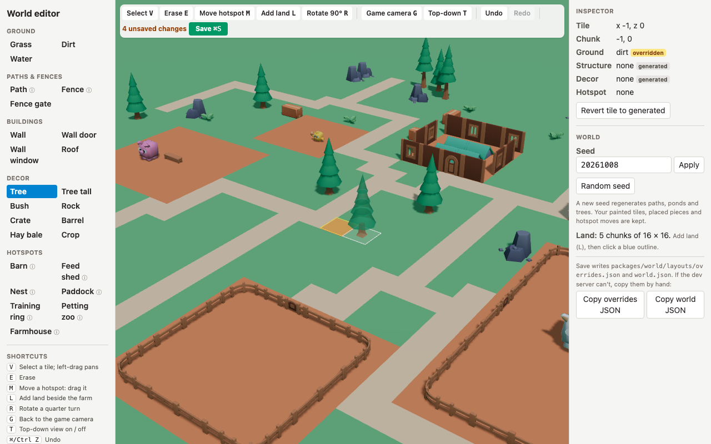

# World editor — how to use it

The world editor lets you change the farm by eye: paint ground, place and
remove pieces, move hotspots, change the seed and add land. It is a developer
tool. It runs only on the dev server and is never part of the game a child
loads. Ticket: SF-76 (#105). Design: ADR-0005.



## Start it

```sh
pnpm install   # once per checkout
pnpm dev       # Vite dev server
```

Open the URL Vite prints with `?edit=1` on the end, for example
<http://localhost:5173/?edit=1>. Without `?edit=1` you get the game.

## The screen

- **Left: the palette.** Every piece the world can hold, in five groups:
  Ground, Paths & fences, Buildings, Decor, Hotspots. Clicking an entry picks
  its tool. An ⓘ means the entry has a note (hover it, or read the blue box
  under the palette once chosen). The shortcut legend is under the palette.
- **Middle: the farm**, drawn with the game's own ground, models and lights.
  A white square follows the cursor; a see-through copy of the piece shows
  where it would go.
- **Top: the toolbar.** Tools, rotation, camera, undo/redo, the count of
  unsaved changes and **Save**.
- **Right: the inspector and the world settings.**

## Tools

| Tool | How | What it does |
| --- | --- | --- |
| Select (V) | Click a tile | Shows it in the inspector. Left-drag pans the camera. |
| Ground: Grass, Dirt, Water, Path | Click or drag | Paints the ground. Paths join up by themselves. Painting path or water clears decor on that tile. |
| Fence, Fence gate, Buildings | Click (R rotates first) | Places a structure. Fences join their neighbours by themselves. |
| Decor | Click (R rotates first) | Places a tree, rock, hay bale and so on. |
| Erase (E) | Click or drag | Takes the top thing off a tile: decor first, then a structure, then painted ground. A piece you placed simply disappears. A piece the generator made gets a "remove" override. |
| Move hotspot (M) | Drag a hotspot by any tile of it | Carries the whole footprint. Paths re-route to it while you drag. The footprint shows green where it may go and red where it may not (off the land, or on another hotspot). |
| Hotspots in the palette | Click a tile | Puts that hotspot's north-west corner on the tile. |
| Add land (L) | Click a blue outline | Adds that 16 × 16 chunk next to the farm. Land you already have does not change. |

The inspector shows the selected tile's coordinate and chunk, then its ground,
structure, decor and hotspot. Each one is marked **generated** (from the seed)
or **overridden** (your edit); a hotspot is marked **layout** (where
`farm.json` puts it) or **moved**. **Revert tile to generated** removes every
override on that tile.

## Camera

| Do | To |
| --- | --- |
| Right-drag (Ctrl-drag on a trackpad) | Orbit |
| Middle-drag, or the arrow keys | Pan |
| Wheel, or pinch | Zoom |
| Game camera (G) | Jump back to the camera the child plays with |
| Top-down (T) | Look straight down at all the land and the land around it; press again to go back |

## Shortcuts

| Keys | Does |
| --- | --- |
| V / E / M / L | Select / Erase / Move hotspot / Add land |
| R | Rotate the piece a quarter turn |
| G / T | Game camera / top-down on and off |
| ⌘Z or Ctrl Z | Undo |
| ⇧⌘Z or Ctrl Shift Z (or Ctrl Y) | Redo |
| ⌘S or Ctrl S | Save |
| Esc | Back to Select, clear the selection |

One drag of a brush is one undo step. Shortcuts are ignored while you type in
the seed box.

## Saving

**Save** (or ⌘S) writes two files in the repo:

- `packages/world/layouts/overrides.json`: your edits, one per line.
- `packages/world/layouts/world.json`: the seed and the list of chunks.

The browser cannot write files, so the dev server does it
(`POST /__editor/overrides` and `POST /__editor/world`, set up in
`apps/web/vite.config.ts`). It checks each file with the same parser the game
uses. If a file would be invalid, nothing is written and the toolbar shows the
reason. The counter next to Save shows how many changes are not yet written.

Saving does not commit. Afterwards, either commit the two files yourself or
ask an agent to open a PR with them. `git diff` shows exactly the lines you
changed. If the dev server is not running, use **Copy overrides JSON** and
**Copy world JSON** and paste them into the files by hand.

## What regeneration keeps

The world is always rebuilt as *generate(seed, land) + your overrides*.
Changing the seed (type one and press Apply, or **Random seed**) regenerates
the paths, ponds, trees and other decor. It **keeps** every override: painted
tiles, placed and removed pieces, and moved hotspots, because the overrides
are applied after the generator runs. Adding land never changes land you
already have.

The file stays small on its own. A new edit on a tile replaces your earlier
edit of the same kind on that tile. An edit that leaves the tile exactly as
the seed would make it (for example, painting grass back onto generated grass)
removes the override rather than adding one.

A few things to know:

- With a new seed, a generated piece you removed may no longer be there, so
  its "remove" override does nothing until something is generated on that
  tile again.
- Editing is on whole tiles with quarter turns only, which is what the tile
  world supports.
- `?edit=1` only works on the dev server. On the deployed game it is ignored
  and the normal game loads; an e2e test checks this.
